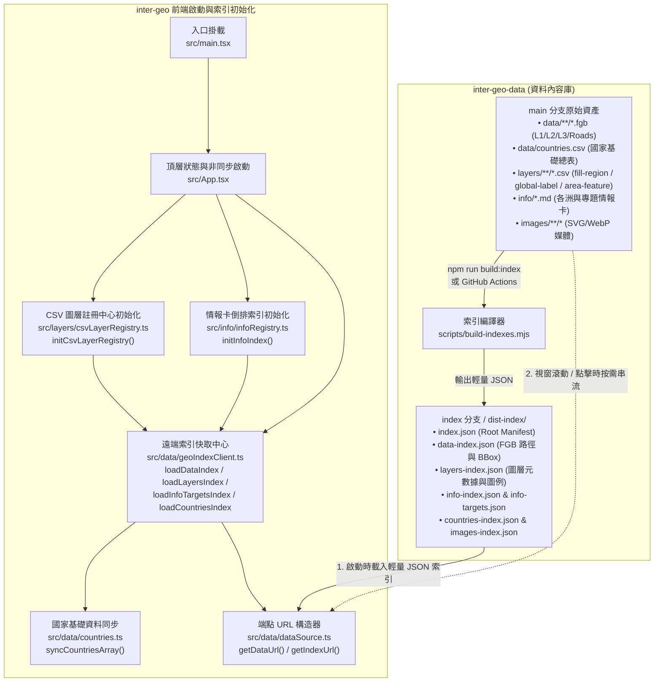
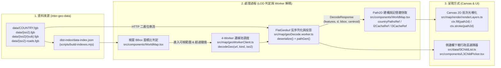
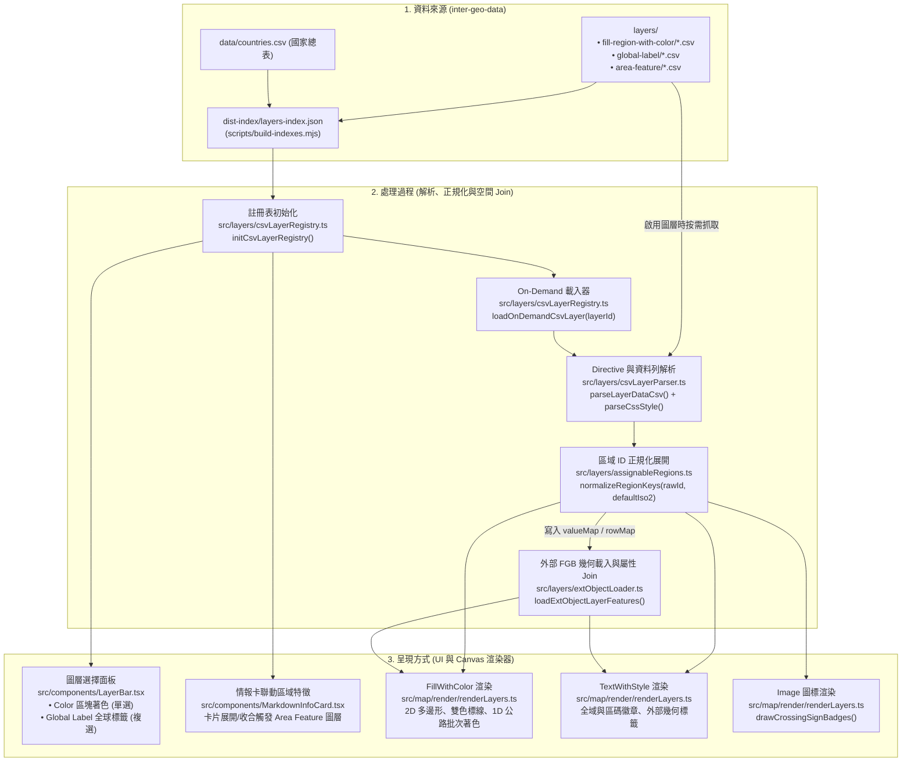
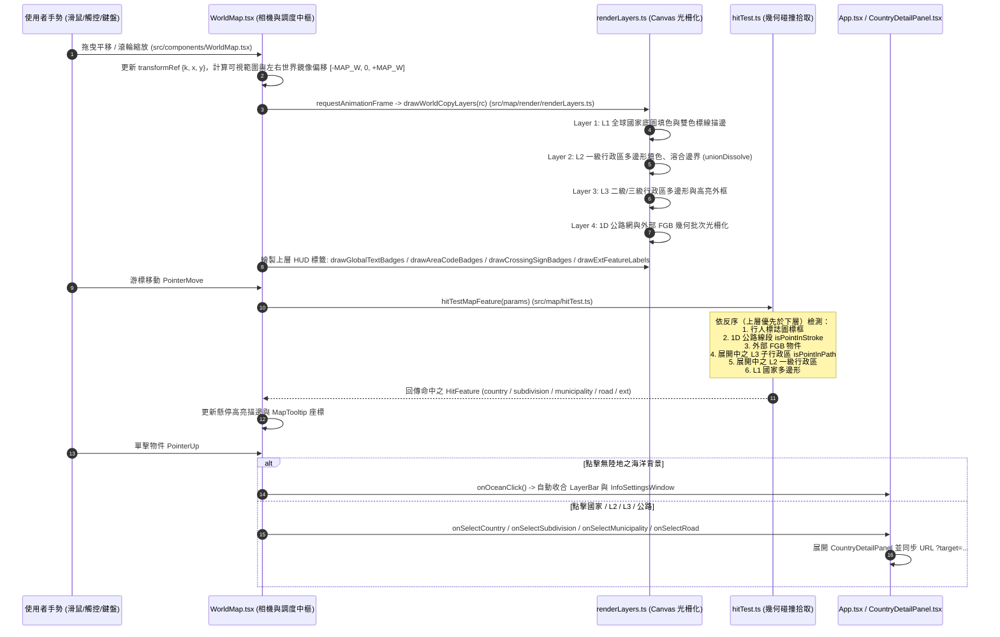
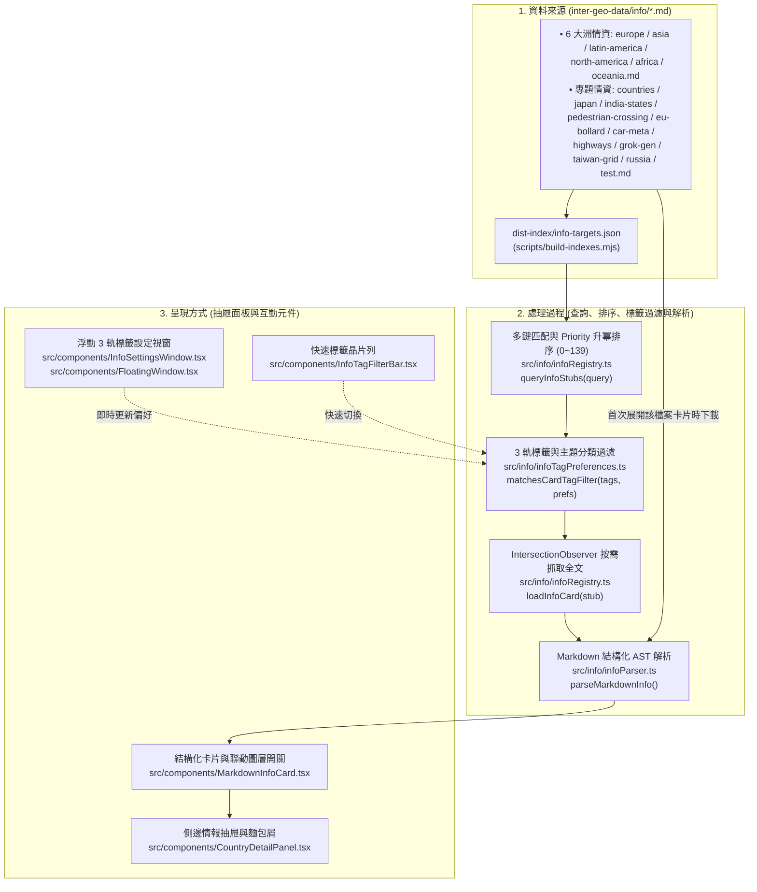
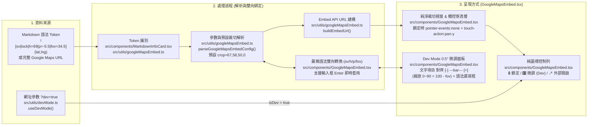
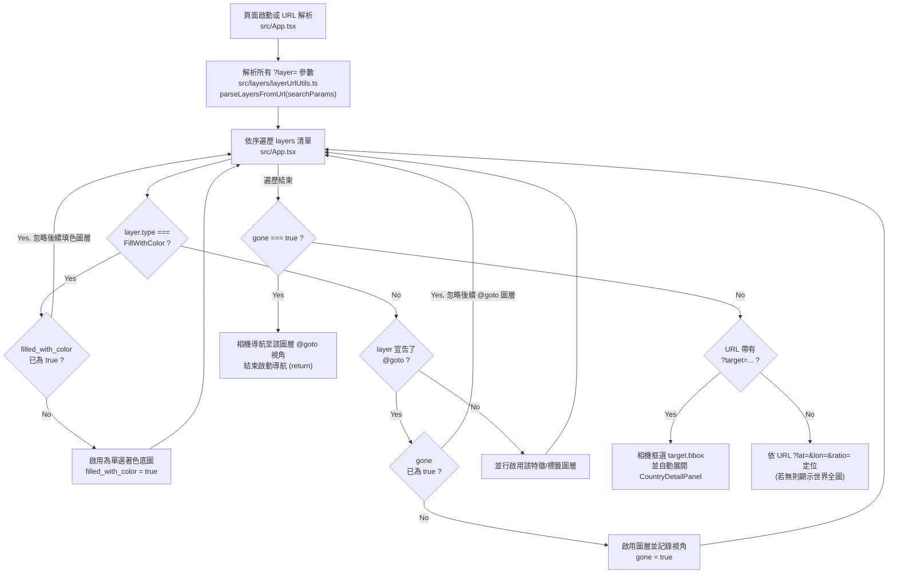

# Inter-Geo: 現代化互動式地理探索與 GeoGuessr 競技輔助系統

Inter-Geo 是一個專為地理探索、實境觀察與 GeoGuessr 競技研判打造的高效能 Web GIS 向量地圖系統。本專案採用純前端、無伺服器後端之**雙儲存庫解耦架構**，結合 HTML5 Canvas 2D 硬體加速、FlatGeobuf (`.fgb`) 二進位空間串流、Web Worker 背景多線程解碼，實現自全球國家輪廓（L1）、一級行政區（L2）至高精度二級／三級行政區（L3+）的平滑下鑽，並深度整合公路路網、雙色道路標線、街景拍攝車特徵、動態 Markdown 情報檔案庫、前端多邊形邊界動態溶合（Union Border Dissolve）與內嵌 Google Street View / 圖層尺寸即時微調回寫器。

---

## 目錄 (Table of Contents)

- [1. 專案核心特色 (Key Features)](#1-專案核心特色-key-features)
- [2. 雙儲存庫解耦架構與啟動總覽 (Multi-Repo Architecture & Bootstrap)](#2-雙儲存庫解耦架構與啟動總覽-multi-repo-architecture--bootstrap)
- [3. 八大核心部件：資料來源、處理過程與呈現方式 (Component Deep Dive)](#3-八大核心部件資料來源處理過程與呈現方式-component-deep-dive)
  - [3.1 部件一：多層次空間向量幾何 (L1 / L2 / L3+ / Roads FGB)](#31-部件一多層次空間向量幾何-l1--l2--l3--roads-fgb)
  - [3.2 部件二：CSV 動態圖層系統與外部空間物件 (CSV Layer System)](#32-部件二csv-動態圖層系統與外部空間物件-csv-layer-system)
  - [3.3 部件三：Canvas 2D 光柵化渲染管線與游標拾取 (Render & Hit-Test Pipeline)](#33-部件三canvas-2d-光柵化渲染管線與游標拾取-render--hit-test-pipeline)
  - [3.4 部件四：Markdown 實戰情報卡與 3 軌標籤篩選系統 (Info Dossiers & 3-Track Tag Planner)](#34-部件四markdown-實戰情報卡與-3-軌標籤篩選系統-info-dossiers--3-track-tag-planner)
  - [3.5 部件五：Google Maps / Street View 嵌入引擎與 Dev Mode 微調器](#35-部件五google-maps--street-view-嵌入引擎與-dev-mode-微調器)
  - [3.6 部件六：地圖 HUD 懸停提示卡 (MapTooltip) 與動態圖例 (MapLegend)](#36-部件六地圖-hud-懸停提示卡-maptooltip-與動態圖例-maplegend)
  - [3.7 部件七：前端一級行政區邊界溶合與標籤質心計算 (Region Union Border Dissolve)](#37-部件七前端一級行政區邊界溶合與標籤質心計算-region-union-border-dissolve)
  - [3.8 部件八：圖層視覺尺寸微調與全端情報卡回寫機制 (Dev Mode Visual Sizing & Live Writer)](#38-部件八圖層視覺尺寸微調與全端情報卡回寫機制-dev-mode-visual-sizing--live-writer)
- [4. URL 路由同步、深層連結與重整協定 (URL Routing & Reload Protocol)](#4-url-路由同步深層連結與重整協定-url-routing--reload-protocol)
- [5. 專案目錄與程式碼完整導覽 (Repository Directory Reference)](#5-專案目錄與程式碼完整導覽-repository-directory-reference)
- [6. 開發任務切入指引 (Where to Start by Task)](#6-開發任務切入指引-where-to-start-by-task)
- [7. 本機開發、建置與 Nginx 部署流程 (Development & Production Workflows)](#7-本機開發建置與-nginx-部署流程-development--production-workflows)

---

## 1. 專案核心特色 (Key Features)

- **單一 Canvas 2D 向量引擎**：捨棄龐大且易觸發 DOM Reflow 的 SVG 節點樹，全系統收攏至 HTML5 Canvas 2D + `Path2D` 預編譯路徑（[`src/map/render/renderLayers.ts`](src/map/render/renderLayers.ts)），在 120Hz/144Hz 螢幕維持滿幀流暢度。
- **純前端雙儲存庫解耦設計**：前端應用庫 (`inter-geo`) 不含任何重型 GIS 圖資、CSV 或 Markdown 文檔；所有空間幾何、圖層與情報全數由資料內容庫（[`inter-geo-data`](https://github.com/harvey-euph/inter-geo-data)）託管，並由 [`scripts/build-indexes.mjs`](https://github.com/harvey-euph/inter-geo-data/blob/main/scripts/build-indexes.mjs) 自動編譯輕量 JSON 索引。
- **視窗動態串流與幾何緊密度判定 (Viewport BBox Culling & Solidity)**：僅下載並解碼當前螢幕可視範圍內的空間多邊形（[`src/components/WorldMap.tsx`](src/components/WorldMap.tsx)），結合多邊形面積與外框比例計算，避免跨海離島國家（美、日、智利等）過早展開下層幾何。
- **結構化分層圖層與情報卡聯動體系**：
  - **全域圖層面板（[`src/components/LayerBar.tsx`](src/components/LayerBar.tsx)）**：專注管理「區塊著色 (`fill-region`)」單選與「全域標籤 (`global-label`)」複選（國碼、電話區號、網域名稱等）。
  - **情報卡聯動區域特徵（[`src/components/MarkdownInfoCard.tsx`](src/components/MarkdownInfoCard.tsx)）**：區域特徵圖層（`area-feature`，如各國公路編號、特定號誌、台電網格等）與情資條目綁定，點擊展開卡片即自動於地圖疊加相應圖層與幾何要素。
- **前端多邊形邊界動態溶合（Region Union Border Dissolve）**：針對同一國家內共享相同郵遞區號或分區代碼的多個行政區（如泰國、法國、日本等），[`src/map/unionDissolve.ts`](src/map/unionDissolve.ts) 能在前端動態消除內部交界線，並以離屏射線投射法重新計算非凸多邊形合併質心，消除跨區標籤碰撞。
- **動態情報檔案庫與 3 軌標籤規劃板**：點擊地圖任意物件即可開啟側邊情報抽屜（[`src/components/CountryDetailPanel.tsx`](src/components/CountryDetailPanel.tsx)）；提供浮動情報設定視窗（[`src/components/InfoSettingsWindow.tsx`](src/components/InfoSettingsWindow.tsx)）進行「必含 / 必不含 / 預設」三軌過濾。
- **純淨 Google Street View 嵌入與 Dev Mode 即時微調器**：支援預設裁切官方 UI 雜訊、鎖定狀態下觸控滑動穿透（`touch-action: pan-y`），並在網址加上 `?dev=true` 時啟用 0.5° 步進滑桿、反向縮放條與最簡語法即時雙向編輯框（[`src/components/GoogleMapsEmbed.tsx`](src/components/GoogleMapsEmbed.tsx)）。
- **圖層尺寸動態調校與情報卡線上回寫**：Dev 模式下可直接對文字與圖標圖層微調視覺尺寸（[`src/components/LayerSizeControls.tsx`](src/components/LayerSizeControls.tsx)），並透過內建開發服務直接在瀏覽器建立/編輯情報卡並自動寫回 [`inter-geo-data`](https://github.com/harvey-euph/inter-geo-data)。

---

## 2. 雙儲存庫解耦架構與啟動總覽 (Multi-Repo Architecture & Bootstrap)

本系統由前端應用庫 `inter-geo` 與資料內容庫 [`inter-geo-data`](https://github.com/harvey-euph/inter-geo-data) 協同運作。應用啟動時，前端優先拉取 `index` 分支的輕量索引，隨後依據使用者互動按需串流 `main` 分支的原始檔案：



---

## 3. 八大核心部件：資料來源、處理過程與呈現方式 (Component Deep Dive)

以下針對系統中每一個核心功能部件，完整說明其 **資料來源 (Data Source)**、**處理過程 (Processing Pipeline)** 與 **呈現方式 (Presentation)**。

---

### 3.1 部件一：多層次空間向量幾何 (L1 / L2 / L3+ / Roads FGB)

| 階段 | 內容說明與關鍵程式碼位置 |
| --- | --- |
| **1. 資料來源** | • **L1 全球國家邊界**：[`data/COUNTRY.fgb`](https://github.com/harvey-euph/inter-geo-data/blob/main/data/COUNTRY.fgb)（177+ 國多邊形）。<br>• **L2 一級行政區**：[`data/{iso2}.fgb`](https://github.com/harvey-euph/inter-geo-data/tree/main/data)（91 國省／州／都道府縣，索引定義於 [`data/l2-manifest.json`](https://github.com/harvey-euph/inter-geo-data/blob/main/data/l2-manifest.json)）。<br>• **L3+ 二級／三級行政區**：[`data/{iso2}/{sub}.fgb`](https://github.com/harvey-euph/inter-geo-data/tree/main/data)（276+ 個微型分區包，如 `data/JP/01.fgb`，定義於 [`data/l3-manifest.json`](https://github.com/harvey-euph/inter-geo-data/blob/main/data/l3-manifest.json)）。<br>• **公路路網與外部幾何**：[`data/{iso2}-roads.fgb`](https://github.com/harvey-euph/inter-geo-data/tree/main/data) 及 [`data/TW-powerpoles.fgb`](https://github.com/harvey-euph/inter-geo-data/blob/main/data/TW-powerpoles.fgb)（定義於 [`data/roads-manifest.json`](https://github.com/harvey-euph/inter-geo-data/blob/main/data/roads-manifest.json)）。<br>• **索引來源**：由 [`scripts/build-indexes.mjs`](https://github.com/harvey-euph/inter-geo-data/blob/main/scripts/build-indexes.mjs) `buildDataIndex()` 彙整輸出為 `dist-index/data-index.json`。 |
| **2. 處理過程** | 1. **索引查詢**：前端透過 [`src/data/geoIndexClient.ts`](src/data/geoIndexClient.ts) `loadDataIndex()` 取得全庫 FGB 清單與 BBox。<br>2. **LOD 視窗面積與緊密度判定**：[`src/components/WorldMap.tsx`](src/components/WorldMap.tsx) `getBBoxScreenAreaRatio()` 計算國家／省州 BBox 佔螢幕可視面積比例，超過閾值 `0.2` 時觸發 L2 或 L3 展開。<br>3. **Web Worker 多線程解碼**：[`src/map/geoWorkerClient.ts`](src/map/geoWorkerClient.ts) `decodeGeo()` 將 URL 發送至 4 線程 Worker Pool。Worker 內 [`src/map/geoDecode.worker.ts`](src/map/geoDecode.worker.ts) `decode()` 以 `flatgeobuf.deserialize()` 進行零拷貝二進位串流反序列化，透過 D3 Web Mercator 投影（[`src/map/geo.ts`](src/map/geo.ts)）預先轉為 SVG Path 字串 `d`、計算外框 `bbox` 與質心 `centroid`，回傳主線程。<br>4. **Path2D 實體化與快取**：主線程 [`src/components/WorldMap.tsx`](src/components/WorldMap.tsx) 將回傳的 `d` 實例化為原生 `new Path2D(d)` 並存入 `countryPathsRef`、`l2CacheRef`、`l3CacheRef`。 |
| **3. 呈現方式** | • **Canvas 分層光柵化**：於 [`src/map/render/renderLayers.ts`](src/map/render/renderLayers.ts) `drawWorldCopyLayers()` 依序繪製 L1 底圖填色、L2 行政區細分線與色彩、Active L3 細部市區町村多邊形，以及固定物理像素線寬（`lineWidth / k`）之公路網。<br>• **側邊欄 L3 清單下鑽**：當選中具備 L3 分區的一級行政區時，[`src/components/CountryDetailPanel.tsx`](src/components/CountryDetailPanel.tsx) 渲染 [`src/components/L3ChildPicker.tsx`](src/components/L3ChildPicker.tsx)，由 [`src/data/l3ChildList.ts`](src/data/l3ChildList.ts) `loadL3ChildrenForSubdivision()` 解碼該省州的 `.fgb` 屬性並列出所有下轄市區町村供點擊定位。 |



---

### 3.2 部件二：CSV 動態圖層系統與外部空間物件 (CSV Layer System)

| 階段 | 內容說明與關鍵程式碼位置 |
| --- | --- |
| **1. 資料來源** | • **國家核心基礎表**：[`data/countries.csv`](https://github.com/harvey-euph/inter-geo-data/blob/main/data/countries.csv)（收錄 180 國 ISO-2、中英文名、國旗、地理分區、街景覆蓋、行駛方向、質心座標等）。<br>• **3 大分類圖層目錄**：<br>  1. [`layers/fill-region-with-color/*.csv`](https://github.com/harvey-euph/inter-geo-data/tree/main/layers/fill-region-with-color)（區塊著色，如 `driving-side.csv`, `road-markings.csv`）<br>  2. [`layers/global-label/*.csv`](https://github.com/harvey-euph/inter-geo-data/tree/main/layers/global-label)（全域標籤，如 `flags.csv`, `calling-code.csv`, `domain-tld.csv`）<br>  3. [`layers/area-feature/*.csv`](https://github.com/harvey-euph/inter-geo-data/tree/main/layers/area-feature)（區域特徵，如 `us-interstates.csv`, `taiwan-power-poles.csv`, `eu-pedestrian-crossing.csv`）<br>• **索引來源**：由 [`scripts/build-indexes.mjs`](https://github.com/harvey-euph/inter-geo-data/blob/main/scripts/build-indexes.mjs) `buildLayersIndex()` 解析所有 CSV 頂部 `// @directive` 標頭輸出為 `dist-index/layers-index.json`；國家表由 `buildCountriesIndex()` 編譯為 `dist-index/countries-index.json`。 |
| **2. 處理過程** | 1. **圖層清單註冊**：[`src/layers/csvLayerRegistry.ts`](src/layers/csvLayerRegistry.ts) `initCsvLayerRegistry()` 讀取 `layers-index.json`，透過 `metaToRegisteredLayer()` 建立圖層目錄。<br>2. **On-Demand 按需下載與 CSV 解析**：當使用者啟用某圖層時，[`src/layers/csvLayerRegistry.ts`](src/layers/csvLayerRegistry.ts) `loadOnDemandCsvLayer()` 下載對應 `.csv` 並交由 [`src/layers/csvLayerParser.ts`](src/layers/csvLayerParser.ts) `parseLayerDataCsv()` 解析。<br>3. **區域代碼正規化**：呼叫 [`src/layers/assignableRegions.ts`](src/layers/assignableRegions.ts) `normalizeRegionKeys()`，將 `JP::01`、`JP-01`、`JP-1`、`01` 等不同格式雙向展開對齊，寫入 `valueMap` 與 `rowMap`。<br>4. **外部 FGB 幾何綁定 (`@fgb`)**：若圖層宣告了 `// @fgb: data/xxx.fgb`，[`src/layers/extObjectLoader.ts`](src/layers/extObjectLoader.ts) `loadExtObjectLayerFeatures()` 會下載該 `.fgb` 並與 CSV 的 `valueMap` / `rowMap` 進行空間屬性 Join，生成 2D 多邊形、1D 線段或 0D 座標標籤之 `ExtFeatureRenderItem[]`。 |
| **3. 呈現方式** | • **圖層控制面板 (`LayerBar`)**：[`src/components/LayerBar.tsx`](src/components/LayerBar.tsx) 集中管理 `fillRegion`（Radio 單選著色底圖）與 `globalLabel`（Checkbox 複選全域文字與區碼標籤）。<br>• **情報卡聯動區域特徵**：區域特徵（`area-feature`）收斂至 [`src/components/MarkdownInfoCard.tsx`](src/components/MarkdownInfoCard.tsx)，使用者在展開情報條目時即自動觸發開關，保持主地圖視覺專注度。<br>• **多元視覺渲染**：於 [`src/map/render/renderLayers.ts`](src/map/render/renderLayers.ts) 分發：<br>  - `FillWithColor`：單色填色、雙色道路標線 `#邊線:#中線`、1D 公路網批次著色。<br>  - `TextWithStyle`：繪製藥丸徽章 `badge`、電力網格大字 `grid-letter` 或純文字。<br>  - `Image`：非同步載入 SVG/WebP 並繪製於質心座標（如行人標誌圖標）。 |



---

### 3.3 部件三：Canvas 2D 光柵化渲染管線與游標拾取 (Render & Hit-Test Pipeline)

為了實現 120 FPS 極致流暢度，地圖引擎將「相機矩陣與手勢追蹤」完全留在 `WorldMap.tsx` 的 `useRef` 中，拖曳與縮放期間旁路 React Re-render，並使 `renderLayers.ts` 與 `hitTest.ts` 嚴格對齊：



---

### 3.4 部件四：Markdown 實戰情報卡與 3 軌標籤篩選系統 (Info Dossiers & 3-Track Tag Planner)

| 階段 | 內容說明與關鍵程式碼位置 |
| --- | --- |
| **1. 資料來源** | • **洲別與專題 Markdown 情報庫**：[`inter-geo-data/info/*.md`](https://github.com/harvey-euph/inter-geo-data/tree/main/info)，包含 6 大洲檔案（`europe.md`, `asia.md`, `latin-america.md`, `north-america.md`, `africa.md`, `oceania.md`）與專題檔案（`countries.md`, `japan.md`, `india-states.md`, `pedestrian-crossing.md`, `eu-bollard.md`, `car-meta.md`, `highways.md`, `grok-gen.md`, `local-admin.md`, `taiwan-grid.md`, `russia.md`, `india.md`, `note.md`, `test.md`）。<br>• **索引來源**：由 [`scripts/build-indexes.mjs`](https://github.com/harvey-euph/inter-geo-data/blob/main/scripts/build-indexes.mjs) `buildInfoIndex()` 掃描所有 `# 標題` 與元數據（`id`, `targets`, `priority`, `tags`, `icon`, `accent`, `image`），輸出輕量存根 `dist-index/info-index.json` 與目標倒排索引 `dist-index/info-targets.json`。 |
| **2. 處理過程** | 1. **倒排索引載入與多候選鍵查詢**：[`src/info/infoRegistry.ts`](src/info/infoRegistry.ts) `initInfoIndex()` 載入 `info-targets.json`。當選取國家、省州、市區町村、公路或電桿時，`queryInfoStubs(query)` 自動組合候選鍵（如 `JP::01`, `JP-01`, `01`, `HOKKAIDO`），並以 **`priority`（`0 ~ 139` 升冪排序，數字越小越優先，單國專屬卡 `1~40` 置頂、多國比較卡 `100~139` 置底）** 排序。<br>2. **3 軌標籤篩選過濾**：[`src/info/infoTagPreferences.ts`](src/info/infoTagPreferences.ts) `matchesCardTagFilter()` 根據使用者在 [`src/components/InfoSettingsWindow.tsx`](src/components/InfoSettingsWindow.tsx) 設定之 9 大主題分類與「必含 (`includeTags`) / 必不含 (`excludeTags`) / 預設」三軌規則過濾卡片清單。<br>3. **On-Demand 全文下載與解析**：卡片進入可視區時，[`src/info/infoRegistry.ts`](src/info/infoRegistry.ts) `loadInfoCard(stub)` 下載對應 `.md` 檔案（具備 Promise 合併與記憶體快取），由 [`src/info/infoParser.ts`](src/info/infoParser.ts) `parseMarkdownInfo()` 解析雙層條目、粗體標籤與媒體 Token。 |
| **3. 呈現方式** | • **側邊情報抽屜 (`CountryDetailPanel`)**：[`src/components/CountryDetailPanel.tsx`](src/components/CountryDetailPanel.tsx) 支援拖曳欄寬、全螢幕展開、層級麵包屑導航與公路盾牌徽章（[`src/components/RoadShieldBadge.tsx`](src/components/RoadShieldBadge.tsx)）。<br>• **無限滾動與結構化卡片 (`MarkdownInfoCard`)**：[`src/components/MarkdownInfoCard.tsx`](src/components/MarkdownInfoCard.tsx) 以 `IntersectionObserver` 實現滾動分頁載入；渲染主題色光暈邊框、`【...】` 醒目膠囊、國家內文跳轉連結、聯動圖層開關與內嵌街景。 |



---

### 3.5 部件五：Google Maps / Street View 嵌入引擎與 Dev Mode 微調器

| 階段 | 內容說明與關鍵程式碼位置 |
| --- | --- |
| **1. 資料來源** | • **Markdown 內嵌語法**：撰寫於 [`inter-geo-data/info/*.md`](https://github.com/harvey-euph/inter-geo-data/tree/main/info) 條目中之 `` 或直接貼入 Google Maps 瀏覽器完整 URL。<br>• **API 金鑰與開發模式狀態**：環境變數 `VITE_GOOGLE_MAPS_API_KEY`（含公開 Fallback Key，[`src/utils/googleMapsEmbed.ts`](src/utils/googleMapsEmbed.ts)）與網址參數 `?dev=true`（[`src/utils/devMode.ts`](src/utils/devMode.ts) `useDevMode()`）。 |
| **2. 處理過程** | 1. **語法識別與參數解析**：[`src/components/MarkdownInfoCard.tsx`](src/components/MarkdownInfoCard.tsx) 呼叫 [`src/utils/googleMapsEmbed.ts`](src/utils/googleMapsEmbed.ts) `isGoogleMapsEmbedToken()` 偵測嵌入標記，透過 `parseGoogleMapsEmbedConfig()` 萃取模式（`streetview` / `view` / `place` / `search` / `directions`）、經緯度、視角（`heading`, `pitch`, `fov` 10°~100°）、四邊裁切 `crop`（預設 `67,58,50,0`）與鎖定狀態 `locked`。<br>2. **Embed URL 構造**：[`src/utils/googleMapsEmbed.ts`](src/utils/googleMapsEmbed.ts) `buildEmbedUrl()` 組合為官方 `https://www.google.com/maps/embed/v1/...` 網址。<br>3. **最簡語法雙向序列化 (Dev Mode)**：[`src/components/GoogleMapsEmbed.tsx`](src/components/GoogleMapsEmbed.tsx) 將微調參數即時轉為最簡縮寫語法（`streetview` $\rightarrow$ `sv`、`heading` $\rightarrow$ `h`、`pitch` $\rightarrow$ `p` 等）；在底部輸入框修改語法並按 `Enter` 即時反向解析並重繪畫面。 |
| **3. 呈現方式** | • **自適應比例與純淨裁切視窗**：[`src/components/GoogleMapsEmbed.tsx`](src/components/GoogleMapsEmbed.tsx) 以預設 16:9 或 4:5 比例配合負邊距 `margin: -top -right -bottom -left` 隱藏 Google 官方標題卡與版權列。<br>• **鎖定狀態觸控滑動穿透**：鎖定時 `iframe` 設為 `pointer-events: none`，外層覆蓋 `touch-action: pan-y` 透明穿透層，確保手機在鎖定街景上可順暢上下滑動整張資訊卡。<br>• **Dev Mode 微調面板**：提供 `0.5°` 步進之水平／垂直／反向縮放（`zoom = 100 - fov`，範圍 `0 ~ 90`）滑桿、四邊裁切滑桿、可讀寫語法輸入框與純圖標複製按鈕。 |



---

### 3.6 部件六：地圖 HUD 懸停提示卡 (MapTooltip) 與動態圖例 (MapLegend)

| 部件 | 資料來源 | 處理過程 | 呈現方式 |
| --- | --- | --- | --- |
| **懸停提示卡 (`MapTooltip`)** | • `hitTest.ts` 命中的當前懸停物件（國家 / L2 / L3 / 公路 / 外部要素）。<br>• `infoRegistry.ts` 該區域的情報卡 Stub 清單。<br>• `csvLayerRegistry.ts` 當前開啟圖層在該區域的數值與標籤。<br>• `infotipPreferences.ts` 儲存在 `localStorage` 的顯示模式設定（[`src/info/infotipPreferences.ts`](src/info/infotipPreferences.ts)）。 | [`src/map/MapTooltip.tsx`](src/map/MapTooltip.tsx) 根據懸停物件類型查詢 `queryInfoStubs()`（套用 3 軌標籤篩選），若處於 `first-item` 模式則非同步呼叫 `loadInfoCard()` 擷取最高優先級卡片的第一條關鍵線索。 | 跟隨游標座標浮動渲染，支援由 [`src/components/Header.tsx`](src/components/Header.tsx) 即時切換 4 種模式：<br>1. 💡 **線索重點 (`first-item`)**<br>2. 🏷️ **特徵膠囊 (`tags-badges`)**<br>3. 📋 **線索清單 (`card-titles`)**<br>4. ⚡ **極簡名稱 (`minimal`)** |
| **動態圖例 (`MapLegend`)** | • 當前啟用的 `FillWithColor` 圖層之 `@legend` 宣告（來自 `layers-index.json` 或 CSV 標頭）。<br>• 當前啟用的 `global-label` 與 `area-feature` 圖層清單。 | [`src/map/MapLegend.tsx`](src/map/MapLegend.tsx) 解析當前主圖層的色塊（包含 `#邊線:#中線` 雙色標線預覽塊）與文字說明，並彙整所有疊加中的標籤與區域特徵圖層。 | 固定於地圖左上方，支援展開／收合切換，並提供點擊個別疊加圖層膠囊直接關閉該圖層之快捷按鈕。 |

---

### 3.7 部件七：前端一級行政區邊界溶合與標籤質心計算 (Region Union Border Dissolve)

| 階段 | 內容說明與關鍵程式碼位置 |
| --- | --- |
| **1. 資料來源** | • 當前啟用之分區代碼圖層（如歐洲各國郵政區碼、泰國郵遞區號等）之 `valueMap`。<br>• 國家一級行政區空間幾何集合 `L2SubdivisionPathData[]`。 |
| **2. 處理過程** | 由 [`src/map/unionDissolve.ts`](src/map/unionDissolve.ts) 主導處理：<br>1. **分組聚類**：`getCountryUnionLayout()` 將共享相同標籤／郵遞區號之一級行政區歸納為 `SubdivisionUnionGroup`。<br>2. **邊界動態溶合 (Border Dissolve)**：對同組多邊形進行路徑合併，區分出外圍輪廓線（`outerBorderPath2D`）與內部交界線（`internalBorderPath2D`）。內部邊界以低透明度繪製或完全消隱，消除地圖幾何視覺碎裂感。<br>3. **非凸多邊形合併質心動態投射 (Ray-Casted Centroid)**：合併後的多邊形常呈現凹陷或帶孔洞的非凸形狀（如包圍內陸湖或環狀省份）。模組透過離屏 Canvas 上下文（`hitTestCtx`）向多方向（`RAY_DIRS`）發射射線，計算位於形狀內部且距離邊界最深的核心座標，確保徽章不會落於海洋或境外。<br>4. **快取機制**：結果寫入 `unionLayoutCache`，避免拖曳地圖時反覆計算。 |
| **3. 呈現方式** | 於 [`src/map/render/renderLayers.ts`](src/map/render/renderLayers.ts) `drawAreaCodeBadges()` 渲染時，多個合併省份僅於合併質心處渲染單一清晰的徽章，徹底防止郵遞區號碰撞與重疊。 |

---

### 3.8 部件八：圖層視覺尺寸微調與全端情報卡回寫機制 (Dev Mode Visual Sizing & Live Writer)

| 階段 | 內容說明與關鍵程式碼位置 |
| --- | --- |
| **1. 資料來源** | • 瀏覽器 URL 包含 `?dev=true`（[`src/utils/devMode.ts`](src/utils/devMode.ts)）。<br>• 本機 Dev 服務端點：Vite 內建中間件 [`vite.config.ts`](vite.config.ts) 或獨立開發進程 [`scripts/dev-layer-size-server.mjs`](scripts/dev-layer-size-server.mjs)（監聽 `127.0.0.1:8091`）。 |
| **2. 處理過程** | 1. **圖層尺寸即時調節**：[`src/components/LayerSizeControls.tsx`](src/components/LayerSizeControls.tsx) 配合 [`src/layers/layerVisualSize.ts`](src/layers/layerVisualSize.ts)，允許對文字圖層（`text`）或圖標圖層（`img`）進行 `[-] / [+]` 步進，即時更新 Canvas 渲染半徑與字級。<br>2. **尺寸回寫持久化**：調節後自動發送 HTTP POST 至 `/inter-geo/@dev/layer-size`，由 [`scripts/layer-size-writer.mjs`](scripts/layer-size-writer.mjs) 更新 [`inter-geo-data/layers/`](https://github.com/harvey-euph/inter-geo-data/tree/main/layers) 內對應 CSV 的視覺標籤宣告。<br>3. **情報文章線上編輯**：[`src/components/NewInfoArticleForm.tsx`](src/components/NewInfoArticleForm.tsx) 提供所見即所得之情報卡草稿編輯器，送出時呼叫 [`src/info/saveInfoArticle.ts`](src/info/saveInfoArticle.ts)，透過 [`scripts/info-article-writer.mjs`](scripts/info-article-writer.mjs) 自動對齊 Markdown 結構並持久化回寫至 [`inter-geo-data/info/*.md`](https://github.com/harvey-euph/inter-geo-data/tree/main/info)。 |
| **3. 呈現方式** | 僅在開發模式下於資訊卡與設定面板中顯示微調按鈕與編輯入口，生產環境完全無縫隱藏，不影響一般使用者體驗。 |

---

## 4. URL 路由同步、深層連結與重整協定 (URL Routing & Reload Protocol)

系統於 [`src/App.tsx`](src/App.tsx) 與 [`src/layers/layerUrlUtils.ts`](src/layers/layerUrlUtils.ts) 實作了決定性的多圖層 URL 解析與相機導航裁決協定：



1. **操作期間的即時 URL 同步（[`src/App.tsx`](src/App.tsx) & [`src/components/WorldMap.tsx`](src/components/WorldMap.tsx)）**：
   - 所有啟用中的圖層依序寫入 `?layer=...`。
   - 點擊開啟情報抽屜時寫入 `&target={id}`，關閉抽屜時移除 `target`。
   - 當開啟的圖層中**沒有任何 `@goto` 圖層**時，平移縮放即時更新 `&lat=...&lon=...&ratio=...`；一旦開啟含有 `@goto` 的圖層，自動自網址清除 `lat/lon/ratio`。
   - 支援 `&dev=true` 開發者模式參數持久化（[`src/utils/devMode.ts`](src/utils/devMode.ts)）。
2. **重新整理 (Reload / F5) 清理機制**：
   - 重新整理時自動捨棄舊有 `lat`、`lon`、`ratio`，僅保留 `layer`、`target` 與 `dev`，確保重新依照上述三級裁決流程精準對焦。

---

## 5. 專案目錄與程式碼完整導覽 (Repository Directory Reference)

### 前端應用庫 (`inter-geo`)

| 檔案相對路徑 | 實際行數 | 核心職責與關鍵函式 |
| --- | :---: | --- |
| [`src/main.tsx`](src/main.tsx) | 19 | React 19 `createRoot` 應用程式入口掛載 |
| [`src/App.tsx`](src/App.tsx) | 954 | 頂層狀態管理、多圖層 URL 路由協議、選取物件協調、全域快捷鍵 |
| [`src/App.css`](src/App.css) | 3,200 | 全系統深色玻璃擬態主題、Canvas 佈局、抽屜、浮動視窗與微調面板樣式 |
| **地圖渲染與幾何核心 (`src/map/`)** | | |
| [`src/components/WorldMap.tsx`](src/components/WorldMap.tsx) | 3,475 | 相機矩陣 (`transformRef`)、手勢互動、可視範圍 Culling、L1/L2/L3 動態排程 |
| [`src/map/render/renderLayers.ts`](src/map/render/renderLayers.ts) | 1,479 | Canvas 2D 光柵化管線：`drawWorldCopyLayers`、雙色標線、溶合邊界描繪、文字徽章與號誌繪製 |
| [`src/map/unionDissolve.ts`](src/map/unionDissolve.ts) | 566 | 前端一級行政區邊界動態溶合（Dissolve）與離屏射線投射多邊形合併質心計算 |
| [`src/map/hitTest.ts`](src/map/hitTest.ts) | 386 | `hitTestMapFeature()` 多層次幾何碰撞拾取（與繪製順序嚴格反向同步） |
| [`src/map/geo.ts`](src/map/geo.ts) | 170 | D3 Web Mercator 投影器、球面距離與多邊形路徑合成工具 |
| [`src/map/geoWorkerClient.ts`](src/map/geoWorkerClient.ts) | 68 | `decodeGeo()` 4 線程 Web Worker Pool 負載均衡調度客戶端 |
| [`src/map/geoDecode.worker.ts`](src/map/geoDecode.worker.ts) | 153 | 背景執行 FlatGeobuf 二進位串流反序列化、座標投影與 BBox/質心計算 |
| [`src/map/MapTooltip.tsx`](src/map/MapTooltip.tsx) | 573 | 游標懸停提示卡，支援 4 種顯示模式與即時第一條線索預覽 |
| [`src/map/MapLegend.tsx`](src/map/MapLegend.tsx) | 359 | 左上角可收合動態圖例卡片、雙色標線色塊與疊加圖層快捷移除 |
| [`src/map/MapControls.tsx`](src/map/MapControls.tsx) | 202 | 右下角縮放、重設視角、全螢幕與測驗入口控制項 |
| [`src/map/hooks/useKeyboardNav.ts`](src/map/hooks/useKeyboardNav.ts) | 396 | 完整鍵盤方向鍵平移、`+/-` 縮放、數字鍵選取與 `ESC` 關閉面板導航 Hook |
| **圖層與空間物件系統 (`src/layers/` & `src/objects/`)** | | |
| [`src/layers/csvLayerRegistry.ts`](src/layers/csvLayerRegistry.ts) | 594 | CSV 圖層註冊中心、`initCsvLayerRegistry()`、`loadOnDemandCsvLayer()` |
| [`src/layers/csvLayerParser.ts`](src/layers/csvLayerParser.ts) | 511 | `parseLayerDataCsv()` 解析 `// @directive` 標頭、圖例、CSS 樣式與 KV 資料列 |
| [`src/layers/extObjectLoader.ts`](src/layers/extObjectLoader.ts) | 275 | `loadExtObjectLayerFeatures()` 載入外部 `.fgb` 並與 CSV 數值進行空間屬性結合 |
| [`src/layers/layerVisualSize.ts`](src/layers/layerVisualSize.ts) | 143 | 管理文字與圖標標籤尺寸微調狀態與 API 請求 |
| [`src/layers/assignableRegions.ts`](src/layers/assignableRegions.ts) | 219 | `normalizeRegionKeys()` 跨國代碼補零、分隔符轉換（`JP::01` $\leftrightarrow$ `JP-01`） |
| [`src/layers/layerUrlUtils.ts`](src/layers/layerUrlUtils.ts) | 80 | `parseLayersFromUrl()`、填色圖層單選判定與 `@goto` 導航檢查 |
| [`src/objects/objectId.ts`](src/objects/objectId.ts) | 99 | 統一空間物件識別碼正規化（`COUNTRY`, `SUBDIVISION`, `MUNICIPALITY`, `ROAD`, `GRID`） |
| [`src/objects/objectRegistry.ts`](src/objects/objectRegistry.ts) | 41 | 全域地理物件目錄查詢介面 |
| **情報卡與偏好設定系統 (`src/info/`)** | | |
| [`src/info/infoRegistry.ts`](src/info/infoRegistry.ts) | 570 | `initInfoIndex()`、`queryInfoStubs()`（優先級排序）、`loadInfoCard()`、樂觀快取更新 |
| [`src/info/infoParser.ts`](src/info/infoParser.ts) | 288 | `parseMarkdownInfo()` 將 Markdown 檔案解析為結構化 `InfoCard[]` |
| [`src/info/infoTagPreferences.ts`](src/info/infoTagPreferences.ts) | 304 | 9 大分類與 3 軌標籤狀態機（`includeTags`, `excludeTags`）與 `localStorage` 持久化 |
| [`src/info/infotipPreferences.ts`](src/info/infotipPreferences.ts) | 82 | 4 種懸停提示卡模式訂閱與持久化 |
| [`src/info/saveInfoArticle.ts`](src/info/saveInfoArticle.ts) | 116 | 前端情報文章回寫 API 客戶端 |
| [`src/info/saveInfoEmbed.ts`](src/info/saveInfoEmbed.ts) | 48 | 前端街景 Embed 標記回寫 API 客戶端 |
| [`src/info/imageUrl.ts`](src/info/imageUrl.ts) | 14 | 將 `/images/...` 相對路徑轉換為遠端 `@geo-data/main/images/...` 完整 URL |
| **遠端資料與索引客戶端 (`src/data/`)** | | |
| [`src/data/dataSource.ts`](src/data/dataSource.ts) | 45 | `getDataUrl()` (`main` 分支) 與 `getIndexUrl()` (`index` 分支) URL 建構器 |
| [`src/data/geoIndexClient.ts`](src/data/geoIndexClient.ts) | 666 | 遠端 `*-index.json` 非同步載入、記憶體快取、別名映射與同步查詢 API |
| [`src/data/countriesParser.ts`](src/data/countriesParser.ts) | 151 | 解析 `countries.csv` 生成 `CountryData` 結構 |
| [`src/data/l3ChildList.ts`](src/data/l3ChildList.ts) | 64 | `loadL3ChildrenForSubdivision()` 讀取二級行政區 `.fgb` 屬性並排序下轄清單 |
| [`src/data/roadsMeta.ts`](src/data/roadsMeta.ts) | 184 | 各國高速公路與國道系統編號規則、盾牌配色與走廊線索解析器 |
| **使用者介面與內嵌組件 (`src/components/` & `src/utils/`)** | | |
| [`src/components/Header.tsx`](src/components/Header.tsx) | 158 | 頂部導航列、圖層面板開關、情報設定開關、4 種懸停模式切換器 |
| [`src/components/LayerBar.tsx`](src/components/LayerBar.tsx) | 299 | 圖層選擇抽屜（管理區塊著色單選與全域標籤複選） |
| [`src/components/CountryDetailPanel.tsx`](src/components/CountryDetailPanel.tsx) | 450 | 右側可調寬度情報抽屜、層級麵包屑導航、L3 選擇器與卡片容器 |
| [`src/components/MarkdownInfoCard.tsx`](src/components/MarkdownInfoCard.tsx) | 1,289 | Markdown 卡片渲染、無限滾動、卡片聯動區域特徵圖層、國家跳轉連結與微調控制項 |
| [`src/components/GoogleMapsEmbed.tsx`](src/components/GoogleMapsEmbed.tsx) | 1,042 | Google Street View / Maps 嵌入視窗、鎖定穿透遮罩、Dev Mode 0.5° 微調面板與最簡語法編輯器 |
| [`src/components/LayerSizeControls.tsx`](src/components/LayerSizeControls.tsx) | 67 | Dev 模式圖層文字與圖標視覺尺寸微調按鈕組件 |
| [`src/components/NewInfoArticleForm.tsx`](src/components/NewInfoArticleForm.tsx) | 849 | Dev 模式情報卡建立與編輯表單視窗 |
| [`src/components/InfoTagFilterBar.tsx`](src/components/InfoTagFilterBar.tsx) | 89 | 頂部情報主題快速標籤晶片列 |
| [`src/components/InfoSettingsWindow.tsx`](src/components/InfoSettingsWindow.tsx) | 518 | 3 軌標籤規劃視窗（必含 / 必不含 / 預設）與即時命中數量預覽 |
| [`src/components/FloatingWindow.tsx`](src/components/FloatingWindow.tsx) | 242 | 支援游標物理傾角動畫之通用可拖曳浮動視窗外框 |
| [`src/components/L3ChildPicker.tsx`](src/components/L3ChildPicker.tsx) | 119 | 一級行政區下轄市區町村／郡縣搜尋與點擊跳轉列表 |
| [`src/components/RoadShieldBadge.tsx`](src/components/RoadShieldBadge.tsx) | 351 | 各國公路編號盾牌 SVG 向量徽章渲染組件 |
| [`src/components/QuizModal.tsx`](src/components/QuizModal.tsx) | 253 | 互動式地理特徵問答測驗視窗 |
| [`src/utils/googleMapsEmbed.ts`](src/utils/googleMapsEmbed.ts) | 576 | 街景語法 Token 解析器、Google URL 參數萃取、四邊裁切與 Embed URL 構造器 |
| [`src/utils/devMode.ts`](src/utils/devMode.ts) | 62 | `?dev=true` 開發者模式偵測與 React 訂閱 Hook |
| **後台輔助腳本與服務 (`scripts/`)** | | |
| [`scripts/dev-layer-size-server.mjs`](scripts/dev-layer-size-server.mjs) | 82 | Dev 模式本機持久化服務（監聽 8091 端口，處理尺寸與文章回寫） |
| [`scripts/layer-size-writer.mjs`](scripts/layer-size-writer.mjs) | 87 | 解析並回寫圖層尺寸標籤至 [`inter-geo-data/layers/*.csv`](https://github.com/harvey-euph/inter-geo-data/tree/main/layers) |
| [`scripts/info-article-writer.mjs`](scripts/info-article-writer.mjs) | 112 | 格式化並回寫情報文章至 [`inter-geo-data/info/*.md`](https://github.com/harvey-euph/inter-geo-data/tree/main/info) |
| [`scripts/info-embed-writer.mjs`](scripts/info-embed-writer.mjs) | 78 | 更新情報卡中街景嵌入視角 Token 至 Markdown 檔案 |
| [`scripts/nginx-start.sh`](scripts/nginx-start.sh) | 35 | 相對路徑自適應啟動 Nginx 與 Dev Helper 服務 |
| [`scripts/nginx-stop.sh`](scripts/nginx-stop.sh) | 25 | 平滑停止 Nginx 與 Dev 服務進程 |
| [`scripts/nginx-reload.sh`](scripts/nginx-reload.sh) | 29 | 熱重載 Nginx 配置與重啟 Dev 服務 |

---

## 6. 開發任務切入指引 (Where to Start by Task)

| 任務目標 | 建議優先修改的檔案 |
| --- | --- |
| **新增或編輯地圖 CSV 圖層** | 於 [`inter-geo-data/layers/`](https://github.com/harvey-euph/inter-geo-data/tree/main/layers) 旗下對應類別目錄新增 `.csv`，並執行 `npm --prefix ../inter-geo-data run build:index`。 |
| **新增或編輯 GeoGuessr 情報卡** | 於 [`inter-geo-data/info/*.md`](https://github.com/harvey-euph/inter-geo-data/tree/main/info) 依洲別或專題編寫，確認 `targets` 與 `priority`（`0~139`，單國 `1~40`、多國比較 `100~139`），再執行 `npm --prefix ../inter-geo-data run build:index`；或在瀏覽器啟動 `?dev=true` 直接透過介面建立回寫。 |
| **使用街景微調器對齊最佳角度** | 在瀏覽器網址加上 `&dev=true` 開啟開發者模式，點擊街景右上角 `🎛️` 圖標展開微調面板（[`src/components/GoogleMapsEmbed.tsx`](src/components/GoogleMapsEmbed.tsx)），調整水平/垂直/縮放後點擊複製圖示即可貼回 Markdown。 |
| **調整相機手勢、LOD 閾值或縮放邏輯** | 修改 [`src/components/WorldMap.tsx`](src/components/WorldMap.tsx)（LOD 展開閾值與指標手勢事件）。 |
| **修改地圖填色、雙色標線或標籤繪製** | 修改 [`src/map/render/renderLayers.ts`](src/map/render/renderLayers.ts)（多邊形與路網）或 [`src/map/unionDissolve.ts`](src/map/unionDissolve.ts)（行政區邊界溶合與合併質心）。 |
| **修改游標命中優先順序** | 修改 [`src/map/hitTest.ts`](src/map/hitTest.ts) `hitTestMapFeature()`。 |
| **修改情報卡候選鍵匹配與排序權重** | 修改 [`src/info/infoRegistry.ts`](src/info/infoRegistry.ts) `queryInfoStubs()`。 |

---

## 7. 本機開發、建置與 Nginx 部署流程 (Development & Production Workflows)

### 前端應用庫 (`inter-geo`)

```bash
# 安裝相依套件
npm install

# 啟動 Vite 開發伺服器 (預設 http://localhost:5173/inter-geo/)
npm run dev

# 執行 ESLint 靜態檢查
npm run lint

# 執行 TypeScript 型別檢查與 Vite 正式環境打包 (輸出至 dist/)
npm run build
```

### 免 Root 自包含 Nginx 正式服務 (`nginx.conf`)

本專案內建無須 Root 權限之可攜式 Nginx 配置（[`nginx.conf`](nginx.conf)），完全採用**相對路徑**設計，能將本機 `dist/` 與同級 `inter-geo-data/` 掛載於 `http://localhost:9222/inter-geo/`：

```bash
# 啟動 Nginx 與 Dev Helper 服務 (預設監聽 9222 端口與 8091 回寫端口)
npm run nginx:start

# 重新載入設定
npm run nginx:reload

# 停止服務
npm run nginx:stop
```

- **前端靜態資源路由**：`/inter-geo/` $\rightarrow$ `dist/`
- **本機索引即時路由**：`/inter-geo/@geo-data/index/` $\rightarrow$ `../inter-geo-data/dist-index/`
- **本機原始資料路由**：`/inter-geo/@geo-data/main/` $\rightarrow$ `../inter-geo-data/`
- **Dev 模式尺寸與文章寫入代理**：`/inter-geo/@dev/` $\rightarrow$ `http://127.0.0.1:8091/`
