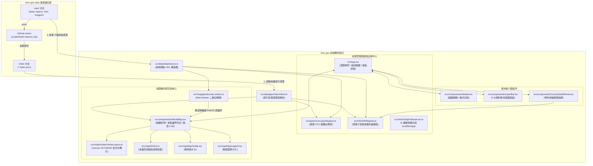
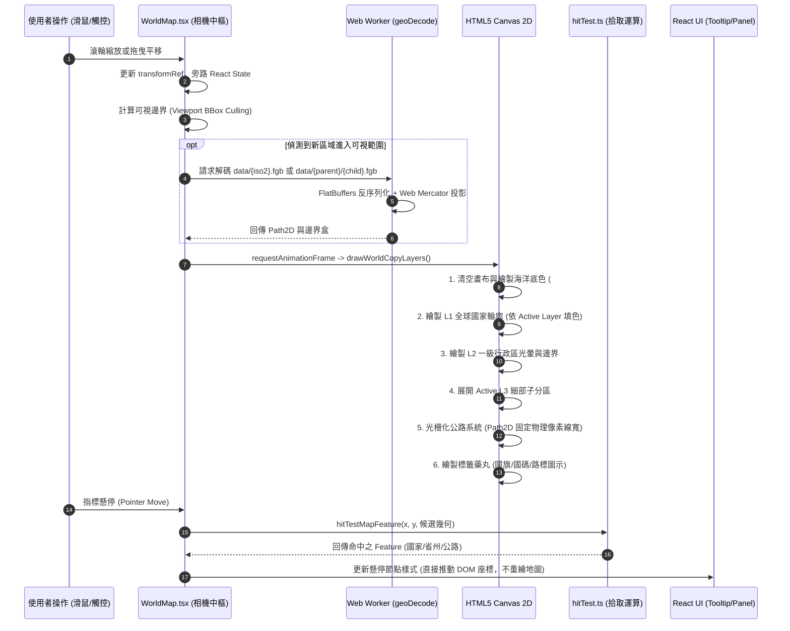
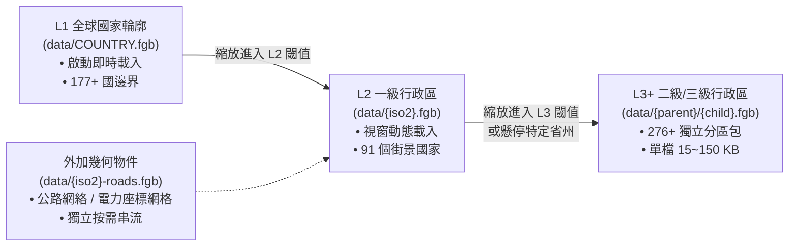

# Inter-Geo: 現代化互動式地理探索與 GeoGuessr 競技輔助系統

Inter-Geo 是一個專為地理探索、實境觀察與 GeoGuessr 競技研判打造的高效能 Web GIS 向量地圖系統。本專案採用純前端、無伺服器後端之**雙儲存庫解耦架構**，結合 HTML5 Canvas 2D 硬體加速、FlatGeobuf 二進位空間串流、Web Worker 背景解碼，實現了自全球國家輪廓（L1）、一級行政區（L2）至高精度二級行政區（L3+）的無限階層平滑下鑽，並深度整合道路網絡、雙色標線、街景拍攝車特徵與動態 Markdown 情報檔案庫。

---

## 目錄 (Table of Contents)

- [1. 專案核心特色 (Key Features)](#1-專案核心特色-key-features)
- [2. 現代雙儲存庫架構 (Decoupled Multi-Repository Architecture)](#2-現代雙儲存庫架構-decoupled-multi-repository-architecture)
- [3. 架構設計與資料流 (Architecture & Data Flow)](#3-架構設計與資料流-architecture--data-flow)
- [4. 渲染管線與效能優化 (Rendering Pipeline & Optimization)](#4-渲染管線與效能優化-rendering-pipeline--optimization)
- [5. 空間資料生命週期與無限階層下鑽 (LOD & Unlimited Hierarchy)](#5-空間資料生命週期與無限階層下鑽-lod--unlimited-hierarchy)
- [6. 動態圖層體系與 CSV 註冊中心 (Layer System & CSV Registry)](#6-動態圖層體系與-csv-註冊中心-layer-system--csv-registry)
- [7. Markdown 情報卡與 Infotip 懸停模式 (Info Dossiers & Infotip Modes)](#7-markdown-情報卡與-infotip-懸停模式-info-dossiers--infotip-modes)
- [8. 專案目錄導覽 (Repository Directory Reference)](#8-專案目錄導覽-repository-directory-reference)
- [9. 開發任務切入指引 (Where to Start by Task)](#9-開發任務切入指引-where-to-start-by-task)
- [10. 本機開發與建置命令 (Development & Build Workflows)](#10-本機開發與建置命令-development--build-workflows)

---

## 1. 專案核心特色 (Key Features)

- **現代單一 Canvas 2D 向量引擎**：全系統捨棄肥重且容易引起 DOM Reflow 的 SVG 節點架構，全面收攏至 HTML5 Canvas 2D + `Path2D` 預編譯幾何路徑，在 120Hz/144Hz 螢幕下維持滿幀 120 FPS 的極限流暢度。
- **純前端解耦雙庫設計**：前端 Web 應用庫 (`inter-geo`) 不含任何重型 GIS 圖資、CSV 數據或 Markdown 文檔；所有空間幾何、圖層與情報卡全數由資料內容庫 (`inter-geo-data`) 集中管理，並透過 GitHub Actions 自動編譯輕量化索引。
- **多層次幾何 LOD 與視窗動態串流 (Viewport BBox Culling)**：僅下載並解碼當前螢幕可視範圍內的空間多邊形，非可視區 0 記憶體與網路負載。
- **無限階層分區下鑽 (Unlimited Hierarchy Recursion)**：突破傳統 L1/L2 兩層限制，支援任意深度的行政區下鑽（如美國 3,200+ 郡、日本 1,900+ 市區町村、德國 400+ 縣轄郡等 276+ 獨立微型分區包）。
- **結構化圖層體系 (Layer System)**：全面統一圖層命名與分類（4 大類別：區塊著色、外加幾何、全域標籤、區域標籤），支援雙色道路標線（邊線/中線）、即時著色與動態圖例。
- **動態情報檔案庫與 4 種懸停模式**：點擊地圖任意物件即可閱讀豐富的 GeoGuessr 判讀情報卡；地圖懸停 Tooltip 提供「線索重點」、「特徵膠囊」、「線索清單」、「極簡名稱」等 4 種顯示模式。
- **無縫換日線橫向世界鏡像 (Continuous World Wrapping)**：支援橫跨經度 180° 國際換日線的連續平移拖曳，消除地圖邊界斷點。
- **高頻 URL 視角同步**：地圖中心經緯度、縮放比例與啟用圖層即時反映於網址列（`?lat=...&lon=...&ratio=...&layer=...`），方便分享與直接深層連結。

---

## 2. 現代雙儲存庫架構 (Decoupled Multi-Repository Architecture)

為了達到極致的載入效能與維護彈性，本專案由兩個職責清晰的 Git 儲存庫協同運作：

```text
┌──────────────────────────────────────────────┐       ┌──────────────────────────────────────────────┐
│         inter-geo (Web 應用程式前端庫)        │       │       inter-geo-data (空間圖資與內容庫)      │
├──────────────────────────────────────────────┤       ├──────────────────────────────────────────────┤
│ • 純 React 19 + TypeScript + Vite            │       │ • FlatGeobuf 空間向量 (data/**/*.fgb)        │
│ • Canvas 2D 幾何投影與光柵化管線              │       │ • CSV 圖層數據庫 (layers/*.csv)              │
│ • Web Worker 背景二進位解碼                 │       │ • Markdown 實戰情報卡 (info/*.md)            │
│ • 互動介面、圖層選擇器、動態圖例、情報側邊欄 │       │ • 類別媒體資源 (images/**/*)                 │
│ • public/ 僅保留最小 web 資源 (globe.svg)    │       │ • 自動化索引編譯 (scripts/build-indexes.mjs) │
└──────────────────────┬───────────────────────┘       └──────────────────────┬───────────────────────┘
                       │                                                      │
                       │             GitHub Actions 自動建置與發布            │
                       │         ┌────────────────────────────────────┐       │
                       └─────────┤ 孤立索引分支 (index branch)        │◄──────┘
                                 │ • data-index.json                  │ (推送 main 時觸發)
                                 │ • layers-index.json                │
                                 │ • info-targets.json                │
                                 │ • images-index.json                │
                                 └────────────────────────────────────┘
```

1. **前端應用庫 (`inter-geo`)**：純前端 SPA，負責相機控制、向量繪製、拾取偵測與狀態調度。
2. **空間資料內容庫 (`inter-geo-data`)**：儲存所有二進位 GIS 幾何（`.fgb`）、CSV 特徵數據（`layers/`）、Markdown 線索卡（`info/`）與圖像資源（`images/`）。
3. **自動化遠端索引 (`index` 分支)**：當 `inter-geo-data` 的 `main` 分支發生更新時，GitHub Action 自動執行 `scripts/build-indexes.mjs`，抽取所有圖層元數據、空間邊界外框 (BBox) 與情報關聯，生成輕量 JSON 索引並推送到孤立的 `index` 分支。
4. **前端按需擷取**：前端透過 `src/data/geoIndexClient.ts` 一次性快取遠端索引，並透過 `src/data/dataSource.ts` 僅在需要時下載特定圖資或文章全文。

---

## 3. 架構設計與資料流 (Architecture & Data Flow)

系統運行時的資料流動與子系統協同關係如下：



### 狀態歸屬與關注點分離 (State Ownership)

- **React 頂層狀態 (`App.tsx`)**：擁有持久化介面狀態（目前選中的國家/行政區/道路物件、啟用的圖層集合、區域專屬圖層狀態、側邊情報抽屜寬度與展開模式）。
- **地圖引擎狀態 (`WorldMap.tsx`)**：擁有相機矩陣變換（`transformRef = { k, x, y }`）、指標手勢追蹤、懸停目標暫存與 `requestAnimationFrame` 繪製調度。**拖曳平移與游標移動期間完全旁路 React 生命週期**，消除 Virtual DOM Diffing，確保 120 FPS 高刷新率。
- **繪圖與拾取嚴格對齊 (`renderLayers.ts` 與 `hitTest.ts`)**：兩者共享相同的投影參數、圖層繪製順序與幾何可視性判定，保證「所見即所選」，杜絕穿透誤觸。

---

## 4. 渲染管線與效能優化 (Rendering Pipeline & Optimization)



### 關鍵效能技術

1. **FlatGeobuf 二進位空間串流 (Zero-Copy Deserialization)**：
   捨棄文字格式的 GeoJSON/TopoJSON，採用 FlatBuffers 架構的二進位 `.fgb` 檔。座標以記憶體對齊的 IEEE 754 浮點數存放，反序列化效能提升 80% 以上，記憶體峰值下降約 70%。
2. **Web Worker 背景多線程解碼 (`geoDecode.worker.ts`)**：
   圖資下載、二進位解碼、多邊形幾何投影運算全數移出瀏覽器主線程，主線程專注於繪圖光柵化與使用者手勢響應。
3. **視窗無關固定線寬 (Window-Fixed Stroke Width)**：
   公路與國界描邊採用物理螢幕像素換算（`lineWidth / k`），無論地圖放大縮小多少倍，線條永保清晰一致，消除放大時粗重失真。
4. **多邊形繞向修復 (Winding Order Normalization)**：
   自動檢測並規範向量外環為順時針、內環為逆時針，避免跨越 180° 經線時出現大西洋破洞或球面反白問題。

---

## 5. 空間資料生命週期與無限階層下鑽 (LOD & Unlimited Hierarchy)

本系統支援平滑且無層級上限的行政區動態下鑽架構：



1. **L1 根幾何 (`data/COUNTRY.fgb`)**：
   應用啟動時載入，提供世界底圖與國家輪廓（每筆要素具備 ISO-2 代碼，如 `JP`、`US`、`TW`）。
2. **L2 動態探索 (`data/{iso2}.fgb`)**：
   透過 `geoIndexClient.hasCountryL2Sync(iso2)` 查閱 `data-index.json`，在該國進入視窗範圍時動態抓取一級行政區幾何。
3. **無限階層分區遞迴 (`data/{parent}/{child}.fgb`)**：
   當某物件在父層幾何內被懸停或選取時，`geoIndexClient.resolveSubdivisionFileSync(parentPath, childId)` 能自動解析下層分區路徑（例如 `data/US/CA.fgb`、`data/JP/13.fgb`）。全系統將 11 個主要大國細切為 276 個微型獨立 `.fgb` 區域包，單檔解析時間僅 ~1ms，頻寬與記憶體節省達 95% 以上。
4. **黏性父層鎖定 (Sticky Parent Lock)**：
   當游標進入某一州/省（如加州、德州、巴伐利亞、東京都）時鎖定該父層，在記憶體展開子多邊形。即使游標掠過水體、海灣或邊界縫隙，父層亦保持穩定展開，平滑過渡絕不閃爍跳動。

---

## 6. 動態圖層體系與 CSV 註冊中心 (Layer System & CSV Registry)

系統將圖層統一抽象為 **Layer**，並於 `inter-geo-data/layers/*.csv` 透過頭部 Directives 聲明：

```csv
// @id: driving-side
// @nameZh: 行駛方向
// @nameEn: Driving Side
// @shortBadge: 🚦 方向
// @group: fill-region
// @type: FillWithColor
// @default-color: #1e2430
// @order: 8
// @descriptionZh: 全球各國道路通行方向（靠左行駛 #f59e0b 與靠右行駛 #3b82f6，無街景或未收錄 #1e2430）制度分布
// @legend: #f59e0b: 靠左行駛 (Left-hand Drive)
// @legend: #3b82f6: 靠右行駛 (Right-hand Drive)
// @legend: #1e2430: 無街景或未收錄
region-id,value,label
JP,#f59e0b,靠左
GB,#f59e0b,靠左
TW,#3b82f6,靠右
US,#3b82f6,靠右
```

### 4 大圖層分類群組 (`LayerBar.tsx`)

| 群組代號 | 名稱 | 選取邏輯 | 適用場景與圖層範例 |
| --- | --- | --- | --- |
| `fill-region` | 區塊著色 | 單選 (Radio) | 預設底圖 (Base)、街景全覽 (Coverage)、行駛方向 (Driving Side)、道路標線 (Road Markings) |
| `ext-object` | 外加物件 | 複選 (Checkbox) | 美國州際公路、美國國道、台灣電力座標系統等非邊界幾何 |
| `global-label` | 全域標籤 | 複選 (Pill) | 國際化藥丸標籤：國旗、國際電話國碼、國家頂級網域 (ccTLD)、通用貨幣符號 |
| `area-label` | 區域標籤 | 複選 (Pill) | 區域性特徵：街道命名詞綴、南亞各邦書寫字母、歐洲人行道告示牌特徵 |

### 雙色道路標線標準 (Double-Color Road Markings)

道路邊界線與中央分向線顏色採用標準格式：`#邊線色:#中線色`（例如 `#f1f5f9:#f59e0b` 代表外側白邊線 + 中央黃線）。渲染引擎檢測到 `:` 分隔符時，自動切換至專屬的雙層筆刷光柵化。

### 通用區域代碼正規化 (`src/layers/assignableRegions.ts`)

提供 `normalizeRegionKeys(rawId, defaultIso2)` 通用函式：
- 支援分向分隔符自動轉換：`JP::26` $\leftrightarrow$ `JP-26` $\leftrightarrow$ `26`。
- 支援數值位數補零：`JP-01` $\leftrightarrow$ `JP-1` $\leftrightarrow$ `01` $\leftrightarrow$ `1`。
- 支援跨國通用命名空間：若指定 `defaultIso2 = 'US'`，輸入 `CA` 自動生成 `['CA', 'US::CA', 'US-CA']`。
- 支援特殊地理格網（如台灣電力座標 `TP-H`）。

### 動態圖例元件 (`MapLegend.tsx`)

地圖左上方配置可自由收合與展開的動態圖例卡片：
- 展開時清楚展示當前著色圖層之色塊與說明文字；在 Base 模式下顯示友善的情境提示。
- 當啟用全域標籤或區域專屬標籤時，自動同步列出已疊加的藥丸徽章。
- 內建 `min-width` 與平滑過渡動畫，避免卡片切換時寬度劇烈跳動。

---

## 7. Markdown 情報卡與 Infotip 懸停模式 (Info Dossiers & Infotip Modes)

情資文章統一撰寫於 `inter-geo-data/info/*.md`，每張卡片皆包含標準元數據：

```markdown
# 日本 (Japan)
- id: country-jp
- targets: JP
- priority: 1
- icon: 🇯🇵
- accent: #38bdf8
- tags: 東亞, 靠左行駛, 官方街景
- type: country
- display: true

- **關鍵線索**: 靠左行駛 (Left Drive) + Low Cam 低視角鏡頭。
- **車牌特徵**: 普通車白底綠字，輕型車（Kei Car）黃底黑字。
- **電線桿**: 桿底常見黃黑相間防撞警示斜紋套管。
```

### 優先級排序與按需讀取

- **優先級定義 (`priority`)**：數值由 `0` 至 `139` 升冪排序（預設 `140`），數字越小優先度越高。
- **即時按需載入 (`infoRegistry.ts`)**：比對 `info-targets.json` 索引以 $O(1)$ 速度命中目標，僅在使用者點擊或懸停時才抓取對應 Markdown 全文，支援請求合併與記憶體快取。

### 4 種 Infotip 懸停提示卡模式

使用者可點擊頂部導航列按鈕即時切換地圖 Tooltip 的呈現方式，設定會自動持久化至 `localStorage`：

1. 💡 **線索重點 (`first-item`)**：提取最高優先級情報卡之第一點核心線索。
2. 🏷️ **特徵膠囊 (`tags-badges`)**：呈現關鍵標籤、通行方向與街景覆蓋等膠囊徽章。
3. 📋 **線索清單 (`card-titles`)**：條列所有適用於該區域的情報主題清單。
4. ⚡ **極簡名稱 (`minimal`)**：極致簡潔，僅呈現國旗、中英文名稱與行政區代碼。

---

## 8. 專案目錄導覽 (Repository Directory Reference)

### 前端應用庫 (`/home/harvey/inter-geo`)

| 檔案 / 目錄路徑 | 系統職責 |
| --- | --- |
| `src/App.tsx` | 應用頂層調度器、選取狀態管理、網址參數解析、側邊欄協調 |
| `src/App.css` | 全系統 CSS 樣式庫（深色現代主題、Canvas 排版、動態圖例、HUD） |
| `src/components/WorldMap.tsx` | 核心地圖組件、Canvas 生命週期、相機手勢、視窗可見性計算、圖資排程 |
| `src/components/Header.tsx` | 頂部導航列、品牌 Logo、圖層面板開關、Infotip 模式切換按鈕 |
| `src/components/LayerBar.tsx` | 4 大類別樹狀圖層面板、關鍵字搜尋過濾、圖層單選/複選控制 |
| `src/components/CountryDetailPanel.tsx` | 點擊物件後彈出的情報抽屜、Markdown 卡片輪播與分頁 |
| `src/components/MarkdownInfoCard.tsx` | 結構化 Markdown 渲染組件，支援強調文字與自訂標籤樣式 |
| `src/map/MapLegend.tsx` | 地圖左上方動態圖例卡片，支援展開/收合、多圖層徽章同步 |
| `src/map/MapTooltip.tsx` | 地圖懸停浮動提示卡，支援 4 種使用者自訂顯示模式 |
| `src/map/MapControls.tsx` | 地圖右下方縮放控制按鈕群（放大、縮小、視角重設） |
| `src/map/render/renderLayers.ts` | Canvas 2D 專屬光柵化繪製管線（底圖、L1/L2 多邊形、公路、標籤） |
| `src/map/hitTest.ts` | 指標碰撞檢測演算法，與繪製管線嚴格同步 |
| `src/map/geo.ts` | 投影變換器（D3 Web Mercator）、地圖維度常數與空間幾何計算 |
| `src/map/geoWorkerClient.ts` | Web Worker 溝通客戶端，封裝 Promise 化解碼請求 |
| `src/map/geoDecode.worker.ts` | Web Worker 背景腳本，執行 FlatGeobuf 反序列化與座標轉換 |
| `src/data/dataSource.ts` | 遠端資料來源 URL 構造中心（統一管理 main 與 index 分支路徑） |
| `src/data/geoIndexClient.ts` | 遠端索引快取客戶端（加載並快取 `*-index.json`） |
| `src/data/layers.ts` | 內建 Preset 圖層定義、圖例常數與 ID 別名解析器 |
| `src/data/globalLayers.ts` | 全域標籤圖層註冊表與文字標籤合成器 |
| `src/data/nationwideLayers.ts` | 國內專屬圖層（公路盾牌、電話區碼、專屬特徵）解析器 |
| `src/info/infoRegistry.ts` | 情報卡查詢中心、優先級排序與非同步 Markdown 獲取 |
| `src/info/infotipPreferences.ts` | 4 種懸停提示模式之狀態訂閱與 `localStorage` 存取 |
| `src/layers/csvLayerRegistry.ts` | 動態 CSV 圖層註冊表、遠端圖層索引同步與數值查詢 |
| `src/layers/assignableRegions.ts` | 通用區域代碼正規化工具（補零、命名空間映射、格網轉換） |
| `src/objects/objectId.ts` | 規範化物件 ID 輔助工具（`country:JP`, `l2:US-CA` 等） |
| `public/globe.svg` | 應用程式 Favicon 向量圖標 |

### 空間資料內容庫 (`/home/harvey/inter-geo-data`)

| 檔案 / 目錄路徑 | 系統職責 |
| --- | --- |
| `data/**/*.fgb` | 全球與各國空間幾何（`COUNTRY.fgb`, `JP.fgb`, `US/CA.fgb`, `US-roads.fgb`） |
| `layers/*.csv` | 標準化 CSV 圖層數據，包含 `@id`, `@group`, `@type` 等頭部 Directives |
| `info/*.md` | 各國與各區域之實戰情報卡，包含 Markdown 內文與元數據 |
| `images/**/*` | 依類別整理之實景圖片資源（交通號誌、防撞柱、特色建築） |
| `scripts/build-indexes.mjs` | Node.js 索引編譯腳本，解析全部數據生成 JSON 索引清單 |
| `.github/workflows/generate-index.yml` | GitHub Actions 工作流程，自動將編譯成果部署至 `index` 分支 |

---

## 9. 開發任務切入指引 (Where to Start by Task)

| 任務目標 | 建議優先修改的檔案 |
| --- | --- |
| **新增或編輯地圖圖層** | 在 `inter-geo-data/layers/*.csv` 新增或修改檔案；推送到 `main` 分支自動重建索引。 |
| **新增或編輯 GeoGuessr 情報卡** | 在 `inter-geo-data/info/*.md` 新增或編寫 Markdown 內容，檢查 `targets` 與 `priority`。 |
| **新增或更新二進位向量邊界** | 將 FlatGeobuf 放至 `inter-geo-data/data/`（遵循 `COUNTRY.fgb` 或 `{parent}/{child}.fgb` 命名規範）。 |
| **調整相機手勢、縮放或平移邏輯** | 修改 `src/components/WorldMap.tsx`，必要時調整 `src/map/geo.ts`。 |
| **修改地圖底色、描邊或圖層著色樣式** | 修改 `src/map/render/renderLayers.ts` 與 `src/map/theme.ts`。 |
| **修改游標物件命中選取或懸停判定** | 修改 `src/map/hitTest.ts`，並確保與 `src/map/render/renderLayers.ts` 的繪製順序一致。 |
| **調整圖層樹狀面板或分類邏輯** | 修改 `src/components/LayerBar.tsx` 與 `src/layers/csvLayerRegistry.ts`。 |
| **調整動態圖例卡片外觀或排版** | 修改 `src/map/MapLegend.tsx` 與 `src/App.css` 中的 `.filter-legend-card` 樣式。 |
| **調整懸停提示卡模式或內容** | 修改 `src/map/MapTooltip.tsx`、`src/info/infotipPreferences.ts` 或 `src/components/Header.tsx`。 |
| **修改行政區代碼對齊或補零邏輯** | 修改 `src/layers/assignableRegions.ts` 或 `src/objects/objectId.ts`。 |
| **修改遠端存取端點或索引加載** | 修改 `src/data/dataSource.ts` 與 `src/data/geoIndexClient.ts`。 |

---

## 10. 本機開發與建置命令 (Development & Build Workflows)

### 環境需求
- Node.js >= 18.0.0
- npm >= 9.0.0

### 前端應用庫 (`inter-geo`)

```bash
# 安裝相依套件
npm install

# 啟動 Vite 開發伺服器 (預設運行於 http://localhost:5173/inter-geo/)
npm run dev

# 執行 ESLint 靜態代碼檢查 (維持 0 error / 0 warning 嚴格標準)
npm run lint

# 執行 TypeScript 型別檢查與 Vite 正式打包建置 (通常 < 2 秒完成)
npm run build

# 本機預覽打包後之正式版本
npm run preview
```

### 資料內容庫 (`inter-geo-data`)

當在 `inter-geo-data` 中編修圖資、CSV 圖層或 Markdown 情報卡時：
1. 本機可手動執行 `node scripts/build-indexes.mjs` 預覽生成之 `dist-index/`。
2. 提交並推送（`git commit` & `git push`）至遠端 `main` 分支。
3. GitHub Actions 將自動觸發並於 ~30 秒內重新發布 `index` 分支，前端應用程式刷新頁面即可立即套用最新資料，無需重新打包前端專案！
