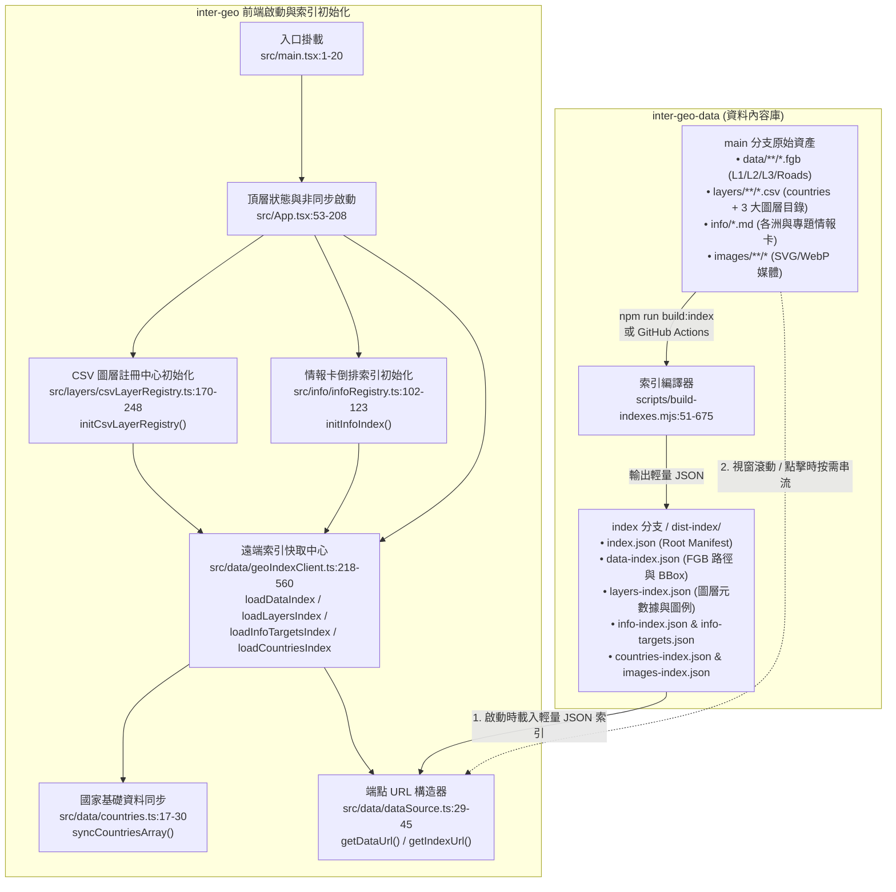
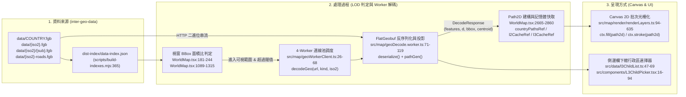
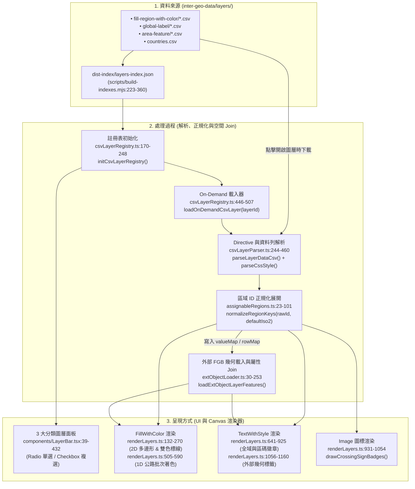
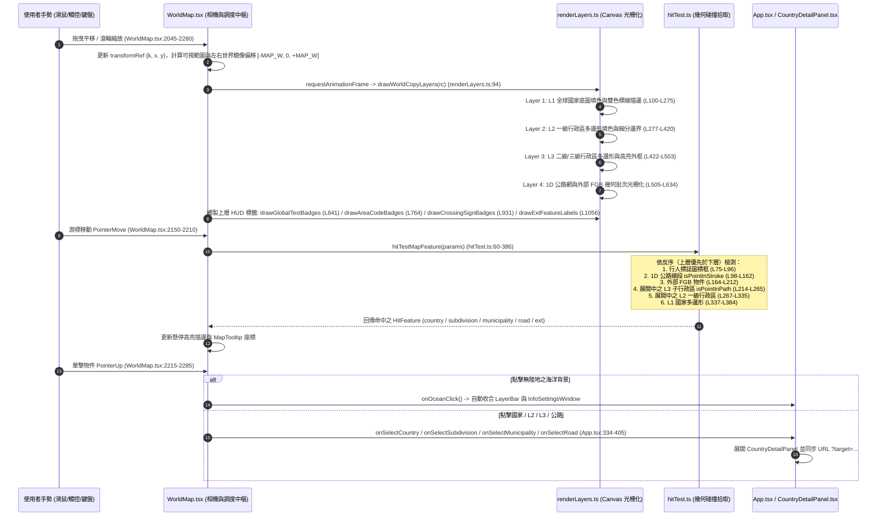
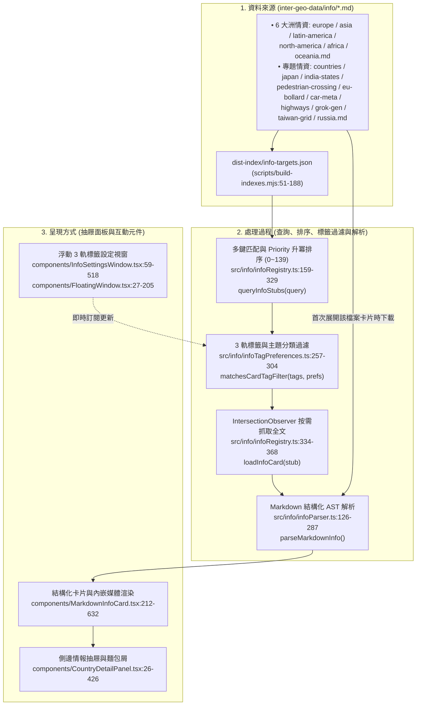
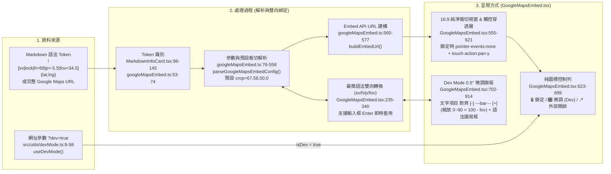
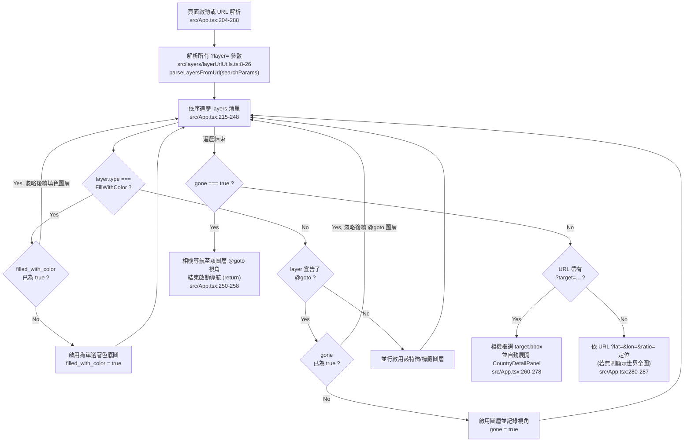

# Inter-Geo: 現代化互動式地理探索與 GeoGuessr 競技輔助系統

Inter-Geo 是一個專為地理探索、實境觀察與 GeoGuessr 競技研判打造的高效能 Web GIS 向量地圖系統。本專案採用純前端、無伺服器後端之**雙儲存庫解耦架構**，結合 HTML5 Canvas 2D 硬體加速、FlatGeobuf (`.fgb`) 二進位空間串流、Web Worker 背景多線程解碼，實現自全球國家輪廓（L1）、一級行政區（L2）至高精度二級／三級行政區（L3+）的平滑下鑽，並深度整合公路路網、雙色道路標線、街景拍攝車特徵、動態 Markdown 情報檔案庫與內嵌 Google Street View 即時微調器。

---

## 目錄 (Table of Contents)

- [1. 專案核心特色 (Key Features)](#1-專案核心特色-key-features)
- [2. 雙儲存庫解耦架構與啟動總覽 (Multi-Repo Architecture & Bootstrap)](#2-雙儲存庫解耦架構與啟動總覽-multi-repo-architecture--bootstrap)
- [3. 六大核心部件：資料來源、處理過程與呈現方式 (Component Deep Dive)](#3-六大核心部件資料來源處理過程與呈現方式-component-deep-dive)
  - [3.1 部件一：多層次空間向量幾何 (L1 / L2 / L3+ / Roads FGB)](#31-部件一多層次空間向量幾何-l1--l2--l3--roads-fgb)
  - [3.2 部件二：CSV 動態圖層系統與外部空間物件 (CSV Layer System)](#32-部件二csv-動態圖層系統與外部空間物件-csv-layer-system)
  - [3.3 部件三：Canvas 2D 光柵化渲染管線與游標拾取 (Render & Hit-Test Pipeline)](#33-部件三canvas-2d-光柵化渲染管線與游標拾取-render--hit-test-pipeline)
  - [3.4 部件四：Markdown 實戰情報卡與 3 軌標籤篩選系統 (Info Dossiers & 3-Track Tag Planner)](#34-部件四markdown-實戰情報卡與-3-軌標籤篩選系統-info-dossiers--3-track-tag-planner)
  - [3.5 部件五：Google Maps / Street View 嵌入引擎與 Dev Mode 微調器](#35-部件五google-maps--street-view-嵌入引擎與-dev-mode-微調器)
  - [3.6 部件六：地圖 HUD 懸停提示卡 (MapTooltip) 與動態圖例 (MapLegend)](#36-部件六地圖-hud-懸停提示卡-maptooltip-與動態圖例-maplegend)
- [4. URL 路由同步、深層連結與重整協定 (URL Routing & Reload Protocol)](#4-url-路由同步深層連結與重整協定-url-routing--reload-protocol)
- [5. 專案目錄與程式碼完整導覽 (Repository Directory Reference)](#5-專案目錄與程式碼完整導覽-repository-directory-reference)
- [6. 開發任務切入指引 (Where to Start by Task)](#6-開發任務切入指引-where-to-start-by-task)
- [7. 本機開發、建置與 Nginx 部署流程 (Development & Production Workflows)](#7-本機開發建置與-nginx-部署流程-development--production-workflows)

---

## 1. 專案核心特色 (Key Features)

- **單一 Canvas 2D 向量引擎**：捨棄龐大且易觸發 DOM Reflow 的 SVG 節點樹，全系統收攏至 HTML5 Canvas 2D + `Path2D` 預編譯路徑（[`renderLayers.ts:94-635`](file:///home/harvey/inter-geo/src/map/render/renderLayers.ts#L94-L635)），在 120Hz/144Hz 螢幕維持滿幀流暢度。
- **純前端雙儲存庫解耦設計**：前端應用庫 (`inter-geo`) 不含任何重型 GIS 圖資、CSV 或 Markdown 文檔；所有空間幾何、圖層與情報全數由資料內容庫 (`inter-geo-data`) 託管，並由 [`build-indexes.mjs`](file:///home/harvey/inter-geo-data/scripts/build-indexes.mjs#L1-L676) 自動編譯輕量 JSON 索引。
- **視窗動態串流與幾何緊密度判定 (Viewport BBox Culling & Solidity)**：僅下載並解碼當前螢幕可視範圍內的空間多邊形（[`WorldMap.tsx:1089-1315`](file:///home/harvey/inter-geo/src/components/WorldMap.tsx#L1089-L1315)），結合多邊形面積與外框比例計算，避免跨海離島國家（美、日、智利等）過早展開下層幾何。
- **3 大結構化圖層體系**：全面支援「區塊著色 (`fill-region`)」、「全域標籤 (`global-label`)」與「區域特徵 (`area-feature`)」（[`LayerBar.tsx:39-432`](file:///home/harvey/inter-geo/src/components/LayerBar.tsx#L39-L432)），涵蓋雙色道路標線（`#邊線:#中線`）、1D 公路網著色、0D 座標點與 SVG 號誌圖標。
- **動態情報檔案庫與 3 軌標籤規劃板**：點擊地圖任意物件即可開啟側邊情報抽屜（[`CountryDetailPanel.tsx:26-426`](file:///home/harvey/inter-geo/src/components/CountryDetailPanel.tsx#L26-L426)）；提供浮動情報設定視窗（[`InfoSettingsWindow.tsx:59-518`](file:///home/harvey/inter-geo/src/components/InfoSettingsWindow.tsx#L59-L518)）進行「必含 / 必不含 / 預設」三軌拖曳過濾。
- **純淨 Google Street View 嵌入與 Dev Mode 即時微調器**：支援預設裁切官方 UI 雜訊、鎖定狀態下觸控滑動穿透（`touch-action: pan-y`），並在網址加上 `?dev=true` 時啟用 0.5° 步進滑桿、反向縮放條與最簡語法即時雙向編輯框（[`GoogleMapsEmbed.tsx:79-918`](file:///home/harvey/inter-geo/src/components/GoogleMapsEmbed.tsx#L79-L918)）。

---

## 2. 雙儲存庫解耦架構與啟動總覽 (Multi-Repo Architecture & Bootstrap)

本系統由前端應用庫 `inter-geo` 與資料內容庫 `inter-geo-data` 協同運作。應用啟動時，前端優先拉取 `index` 分支的輕量索引，隨後依據使用者互動按需串流 `main` 分支的原始檔案：



---

## 3. 六大核心部件：資料來源、處理過程與呈現方式 (Component Deep Dive)

以下針對系統中每一個核心功能部件，完整說明其 **資料來源 (Data Source)**、**處理過程 (Processing Pipeline)** 與 **呈現方式 (Presentation)**，並標註對應之程式碼 `file:line`。

---

### 3.1 部件一：多層次空間向量幾何 (L1 / L2 / L3+ / Roads FGB)

| 階段 | 內容說明與關鍵程式碼位置 |
| --- | --- |
| **1. 資料來源** | • **L1 全球國家邊界**：`inter-geo-data/data/COUNTRY.fgb`（177+ 國多邊形）。<br>• **L2 一級行政區**：`inter-geo-data/data/{iso2}.fgb`（91 國省／州／都道府縣，索引定義於 `data/l2-manifest.json`）。<br>• **L3+ 二級／三級行政區**：`inter-geo-data/data/{iso2}/{sub}.fgb`（276+ 個微型分區包，如 `data/JP/01.fgb`，定義於 `data/l3-manifest.json`）。<br>• **公路路網與外部幾何**：`inter-geo-data/data/{iso2}-roads.fgb` 及 `data/TW-powerpoles.fgb`（定義於 `data/roads-manifest.json`）。<br>• **索引來源**：由 [`scripts/build-indexes.mjs:365-439`](file:///home/harvey/inter-geo-data/scripts/build-indexes.mjs#L365-L439) `buildDataIndex()` 彙整輸出為 `dist-index/data-index.json`。 |
| **2. 處理過程** | 1. **索引查詢**：前端透過 [`geoIndexClient.ts:218-287`](file:///home/harvey/inter-geo/src/data/geoIndexClient.ts#L218-L287) `loadDataIndex()` 取得全庫 FGB 清單與 BBox。<br>2. **LOD 視窗面積與緊密度判定**：[`WorldMap.tsx:193-244`](file:///home/harvey/inter-geo/src/components/WorldMap.tsx#L193-L244) `getBBoxScreenAreaRatio()` 計算國家／省州 BBox 佔螢幕可視面積比例，超過閾值 `0.2`（[`WorldMap.tsx:181-186`](file:///home/harvey/inter-geo/src/components/WorldMap.tsx#L181-L186)）時觸發 L2 或 L3 展開。<br>3. **Web Worker 多線程解碼**：[`geoWorkerClient.ts:55-68`](file:///home/harvey/inter-geo/src/map/geoWorkerClient.ts#L55-L68) `decodeGeo()` 將 URL 發送至 4 線程 Worker Pool。Worker 內 [`geoDecode.worker.ts:71-119`](file:///home/harvey/inter-geo/src/map/geoDecode.worker.ts#L71-L119) `decode()` 以 `flatgeobuf.deserialize()` 進行零拷貝二進位串流反序列化，透過 D3 Web Mercator 投影（[`geo.ts:10-22`](file:///home/harvey/inter-geo/src/map/geo.ts#L10-L22)）預先轉為 SVG Path 字串 `d`、計算外框 `bbox` 與質心 `centroid`，回傳主線程。<br>4. **Path2D 實體化與快取**：主線程 [`WorldMap.tsx:2665-2860`](file:///home/harvey/inter-geo/src/components/WorldMap.tsx#L2665-L2860) 將回傳的 `d` 實例化為原生 `new Path2D(d)` 並存入 `countryPathsRef`、`l2CacheRef`、`l3CacheRef`。 |
| **3. 呈現方式** | • **Canvas 分層光柵化**：於 [`renderLayers.ts:94-635`](file:///home/harvey/inter-geo/src/map/render/renderLayers.ts#L94-L635) `drawWorldCopyLayers()` 依序繪製 L1 底圖填色、L2 行政區細分線與色彩、Active L3 細部市區町村多邊形，以及固定物理像素線寬（`lineWidth / k`）之公路網。<br>• **側邊欄 L3 清單下鑽**：當選中具備 L3 分區的一級行政區時，[`CountryDetailPanel.tsx:365-372`](file:///home/harvey/inter-geo/src/components/CountryDetailPanel.tsx#L365-L372) 渲染 [`L3ChildPicker.tsx:16-94`](file:///home/harvey/inter-geo/src/components/L3ChildPicker.tsx#L16-L94)，由 [`l3ChildList.ts:47-69`](file:///home/harvey/inter-geo/src/data/l3ChildList.ts#L47-L69) `loadL3ChildrenForSubdivision()` 解碼該省州的 `.fgb` 屬性並列出所有下轄市區町村供點擊定位。 |



---

### 3.2 部件二：CSV 動態圖層系統與外部空間物件 (CSV Layer System)

| 階段 | 內容說明與關鍵程式碼位置 |
| --- | --- |
| **1. 資料來源** | • **國家核心基礎表**：`inter-geo-data/layers/countries.csv`（收錄 180 國 ISO-2、中英文名、國旗、地理分區、街景覆蓋、行駛方向、質心座標等）。<br>• **3 大分類圖層目錄**：<br>  1. `layers/fill-region-with-color/*.csv`（區塊著色，如 `driving-side.csv`, `road-markings.csv`）<br>  2. `layers/global-label/*.csv`（全域標籤，如 `flags.csv`, `calling-code.csv`, `domain-tld.csv`）<br>  3. `layers/area-feature/*.csv`（區域特徵，如 `us-interstates.csv`, `taiwan-power-poles.csv`, `eu-pedestrian-crossing.csv`）<br>• **索引來源**：由 [`scripts/build-indexes.mjs:223-360`](file:///home/harvey/inter-geo-data/scripts/build-indexes.mjs#L223-L360) `buildLayersIndex()` 解析所有 CSV 頂部 `// @directive` 標頭，編譯為 `dist-index/layers-index.json`；國家表由 [`build-indexes.mjs:566-582`](file:///home/harvey/inter-geo-data/scripts/build-indexes.mjs#L566-L582) 編譯為 `dist-index/countries-index.json`。 |
| **2. 處理過程** | 1. **圖層清單註冊**：[`csvLayerRegistry.ts:170-248`](file:///home/harvey/inter-geo/src/layers/csvLayerRegistry.ts#L170-L248) `initCsvLayerRegistry()` 讀取 `layers-index.json`，透過 `metaToRegisteredLayer()`（[`csvLayerRegistry.ts:72-151`](file:///home/harvey/inter-geo/src/layers/csvLayerRegistry.ts#L72-L151)）建立圖層目錄樹。<br>2. **On-Demand 按需下載與 CSV 解析**：當使用者啟用某圖層時，[`csvLayerRegistry.ts:446-507`](file:///home/harvey/inter-geo/src/layers/csvLayerRegistry.ts#L446-L507) `loadOnDemandCsvLayer()` 下載對應 `.csv` 並交由 [`csvLayerParser.ts:244-460`](file:///home/harvey/inter-geo/src/layers/csvLayerParser.ts#L244-L460) `parseLayerDataCsv()` 解析。<br>3. **區域代碼正規化**：解析期間呼叫 [`assignableRegions.ts:23-101`](file:///home/harvey/inter-geo/src/layers/assignableRegions.ts#L23-L101) `normalizeRegionKeys()`，將 `JP::01`、`JP-01`、`JP-1`、`01` 等不同寫法雙向展開對齊，寫入 `valueMap` 與 `rowMap`。<br>4. **外部 FGB 幾何綁定 (`@fgb`)**：若圖層宣告了 `// @fgb: data/xxx.fgb`，[`extObjectLoader.ts:30-253`](file:///home/harvey/inter-geo/src/layers/extObjectLoader.ts#L30-L253) `loadExtObjectLayerFeatures()` 會下載該 `.fgb` 並與 CSV 的 `valueMap` / `rowMap` 進行空間屬性 Join，生成 2D 多邊形、1D 線段或 0D 座標標籤之 `ExtFeatureRenderItem[]`。 |
| **3. 呈現方式** | • **圖層控制面板 (`LayerBar`)**：[`LayerBar.tsx:39-432`](file:///home/harvey/inter-geo/src/components/LayerBar.tsx#L39-L432) 將註冊圖層分為 `fill-region`（Radio 單選）、`global-label`（Checkbox 複選）、`area-feature`（Checkbox 複選）三大折疊群組並支援關鍵字即時過濾。<br>• **多元視覺渲染**：於 [`renderLayers.ts`](file:///home/harvey/inter-geo/src/map/render/renderLayers.ts) 根據 `@type` 分發：<br>  - `FillWithColor`：單色填色（[`renderLayers.ts:132-270`](file:///home/harvey/inter-geo/src/map/render/renderLayers.ts#L132-L270)）、雙色道路標線 `#邊線:#中線`（[`renderLayers.ts:200-235`](file:///home/harvey/inter-geo/src/map/render/renderLayers.ts#L200-L235)）、1D 公路網批次著色（[`renderLayers.ts:505-590`](file:///home/harvey/inter-geo/src/map/render/renderLayers.ts#L505-L590)）。<br>  - `TextWithStyle`：繪製藥丸徽章 `badge`、電力網格大字 `grid-letter` 或純文字（[`renderLayers.ts:641-925, 1056-1160`](file:///home/harvey/inter-geo/src/map/render/renderLayers.ts#L641-L925)）。<br>  - `Image`：非同步載入 SVG/WebP 並繪製於質心座標（[`renderLayers.ts:931-1054`](file:///home/harvey/inter-geo/src/map/render/renderLayers.ts#L931-L1054) `drawCrossingSignBadges()`）。 |



---

### 3.3 部件三：Canvas 2D 光柵化渲染管線與游標拾取 (Render & Hit-Test Pipeline)

為了實現 120 FPS 極致流暢度，地圖引擎將「相機矩陣與手勢追蹤」完全留在 `WorldMap.tsx` 的 `useRef` 中，拖曳與縮放期間旁路 React Re-render，並使 `renderLayers.ts` 與 `hitTest.ts` 嚴格對齊：



---

### 3.4 部件四：Markdown 實戰情報卡與 3 軌標籤篩選系統 (Info Dossiers & 3-Track Tag Planner)

| 階段 | 內容說明與關鍵程式碼位置 |
| --- | --- |
| **1. 資料來源** | • **洲別與專題 Markdown 情報庫**：`inter-geo-data/info/*.md`，包含 6 大洲檔案（`europe.md`, `asia.md`, `latin-america.md`, `north-america.md`, `africa.md`, `oceania.md`）與專題檔案（`countries.md`, `japan.md`, `india-states.md`, `pedestrian-crossing.md`, `eu-bollard.md`, `car-meta.md`, `highways.md`, `grok-gen.md`, `local-admin.md`, `taiwan-grid.md`, `russia.md`, `india.md`, `note.md`）。<br>• **索引來源**：由 [`scripts/build-indexes.mjs:51-188`](file:///home/harvey/inter-geo-data/scripts/build-indexes.mjs#L51-L188) `buildInfoIndex()` 掃描所有 `# 標題` 與元數據（`id`, `targets`, `priority`, `tags`, `icon`, `accent`, `image`），輸出輕量存根 `dist-index/info-index.json` 與目標倒排索引 `dist-index/info-targets.json`。 |
| **2. 處理過程** | 1. **倒排索引載入與多候選鍵查詢**：[`infoRegistry.ts:102-123`](file:///home/harvey/inter-geo/src/info/infoRegistry.ts#L102-L123) 載入 `info-targets.json`。當使用者選取國家、省州、市區町村、公路或台電網格時，[`infoRegistry.ts:159-329`](file:///home/harvey/inter-geo/src/info/infoRegistry.ts#L159-L329) `queryInfoStubs(query)` 自動組合候選鍵（如 `JP::01`, `JP-01`, `01`, `HOKKAIDO`），並以 **`priority`（`0 ~ 139` 升冪排序，數字越小越優先，單國專屬卡 `1~40` 置頂、多國比較卡 `100~139` 置底）** 進行嚴格排序（[`infoRegistry.ts:307-312`](file:///home/harvey/inter-geo/src/info/infoRegistry.ts#L307-L312)）。<br>2. **3 軌標籤篩選過濾**：[`infoTagPreferences.ts:257-304`](file:///home/harvey/inter-geo/src/info/infoTagPreferences.ts#L257-L304) `matchesCardTagFilter()` 根據使用者在 [`InfoSettingsWindow.tsx:59-518`](file:///home/harvey/inter-geo/src/components/InfoSettingsWindow.tsx#L59-L518) 設定之 9 大興趣主題分類與「必含 (`includeTags`) / 必不含 (`excludeTags`) / 預設」三軌規則過濾卡片清單。<br>3. **On-Demand 全文下載與解析**：僅當卡片進入可視區時，[`infoRegistry.ts:334-368`](file:///home/harvey/inter-geo/src/info/infoRegistry.ts#L334-L368) `loadInfoCard(stub)` 下載對應 `.md` 檔案（具備 In-Flight Promise 合併與記憶體快取），交由 [`infoParser.ts:267-287`](file:///home/harvey/inter-geo/src/info/infoParser.ts#L267-L287) `parseMarkdownInfo()` 解析雙層條目、粗體標籤與媒體 Token。 |
| **3. 呈現方式** | • **側邊情報抽屜 (`CountryDetailPanel`)**：[`CountryDetailPanel.tsx:26-426`](file:///home/harvey/inter-geo/src/components/CountryDetailPanel.tsx#L26-L426) 支援拖曳調整欄寬、全螢幕展開、麵包屑導航（國家 › 一級行政區 › 二級行政區）與公路盾牌徽章（[`RoadShieldBadge.tsx:11-94`](file:///home/harvey/inter-geo/src/components/RoadShieldBadge.tsx#L11-L94)）。<br>• **無限滾動與結構化卡片 (`MarkdownInfoCard`)**：[`MarkdownInfoCard.tsx:502-632`](file:///home/harvey/inter-geo/src/components/MarkdownInfoCard.tsx#L502-L632) `MarkdownInfoCards` 以 `IntersectionObserver` 實現滾動分頁載入；單張卡片（[`MarkdownInfoCard.tsx:212-480`](file:///home/harvey/inter-geo/src/components/MarkdownInfoCard.tsx#L212-L480)）渲染主題色光暈邊框、`【...】` 醒目膠囊、可點擊跳轉之國家名稱連結與內嵌圖標／街景。 |



---

### 3.5 部件五：Google Maps / Street View 嵌入引擎與 Dev Mode 微調器

| 階段 | 內容說明與關鍵程式碼位置 |
| --- | --- |
| **1. 資料來源** | • **Markdown 內嵌語法**：撰寫於 `inter-geo-data/info/*.md` 條目中之 `` 或直接貼入之 Google Maps 瀏覽器完整 URL。<br>• **API 金鑰與開發模式狀態**：環境變數 `VITE_GOOGLE_MAPS_API_KEY`（含公開 Fallback Key，[`googleMapsEmbed.ts:41-51`](file:///home/harvey/inter-geo/src/utils/googleMapsEmbed.ts#L41-L51)）與網址參數 `?dev=true`（[`devMode.ts:9-58`](file:///home/harvey/inter-geo/src/utils/devMode.ts#L9-L58) `useDevMode()`）。 |
| **2. 處理過程** | 1. **語法識別與參數解析**：[`MarkdownInfoCard.tsx:96-145`](file:///home/harvey/inter-geo/src/components/MarkdownInfoCard.tsx#L96-L145) 呼叫 [`googleMapsEmbed.ts:53-74`](file:///home/harvey/inter-geo/src/utils/googleMapsEmbed.ts#L53-L74) `isGoogleMapsEmbedToken()` 偵測嵌入標記，並透過 [`googleMapsEmbed.ts:76-558`](file:///home/harvey/inter-geo/src/utils/googleMapsEmbed.ts#L76-L558) `parseGoogleMapsEmbedConfig()` 萃取模式（`streetview` / `view` / `place` / `search` / `directions`）、經緯度、視角（`heading`, `pitch`, `fov` 10°~100°）、四邊裁切 `crop`（預設 `67,58,50,0`）與鎖定狀態 `locked`。<br>2. **Embed URL 構造**：[`googleMapsEmbed.ts:560-577`](file:///home/harvey/inter-geo/src/utils/googleMapsEmbed.ts#L560-L577) `buildEmbedUrl()` 組合為官方 `https://www.google.com/maps/embed/v1/...` 網址。<br>3. **最簡語法雙向序列化 (Dev Mode)**：[`GoogleMapsEmbed.tsx:235-305`](file:///home/harvey/inter-geo/src/components/GoogleMapsEmbed.tsx#L235-L305) 將當前微調參數即時轉為最簡縮寫語法（`streetview` $\rightarrow$ `sv`、`heading` $\rightarrow$ `h`、`pitch` $\rightarrow$ `p`、`crop-v` $\rightarrow$ `v` 等）；使用者於底部輸入框修改語法並按下 `Enter` 時，[`GoogleMapsEmbed.tsx:311-340`](file:///home/harvey/inter-geo/src/components/GoogleMapsEmbed.tsx#L311-L340) 即時反向解析並重繪畫面。 |
| **3. 呈現方式** | • **自適應比例與純淨裁切視窗**：[`GoogleMapsEmbed.tsx:555-621`](file:///home/harvey/inter-geo/src/components/GoogleMapsEmbed.tsx#L555-L621) 以預設 16:9 比例配合負邊距 `margin: -top -right -bottom -left` 隱藏 Google 官方標題卡、羅盤與版權列。<br>• **鎖定狀態觸控滑動穿透**：鎖定時 `iframe` 設為 `pointer-events: none`（[`GoogleMapsEmbed.tsx:598`](file:///home/harvey/inter-geo/src/components/GoogleMapsEmbed.tsx#L598)），外層覆蓋 `touch-action: pan-y` 透明穿透層（[`GoogleMapsEmbed.tsx:608-617`](file:///home/harvey/inter-geo/src/components/GoogleMapsEmbed.tsx#L608-L617)），確保手機與觸控板在鎖定街景上可順暢上下滑動整張資訊卡。<br>• **純圖標懸停控制項**：右上角配置純圖標按鈕（[`GoogleMapsEmbed.tsx:623-699`](file:///home/harvey/inter-geo/src/components/GoogleMapsEmbed.tsx#L623-L699)）：`Lock`/`Unlock`（鎖定切換）、`SlidersHorizontal`（僅 `?dev=true` 顯示之微調開關）、`ExternalLink`（跳出 Google Maps 原生網頁）。<br>• **Dev Mode 微調面板**：[`GoogleMapsEmbed.tsx:702-914`](file:///home/harvey/inter-geo/src/components/GoogleMapsEmbed.tsx#L702-L914) 提供 `0.5°` 步進之水平／垂直／反向縮放（`zoom = 100 - fov`，範圍 `0 ~ 90`）滑桿、四邊裁切滑桿、可讀寫語法輸入框與純圖標複製按鈕。 |



---

### 3.6 部件六：地圖 HUD 懸停提示卡 (MapTooltip) 與動態圖例 (MapLegend)

| 部件 | 資料來源 | 處理過程 | 呈現方式 |
| --- | --- | --- | --- |
| **懸停提示卡 (`MapTooltip`)** | • `hitTest.ts` 命中的當前懸停物件（國家 / L2 / L3 / 公路 / 外部要素）。<br>• `infoRegistry.ts` 該區域的情報卡 Stub 清單。<br>• `csvLayerRegistry.ts` 當前開啟圖層在該區域的數值與標籤。<br>• `infotipPreferences.ts` 儲存在 `localStorage` 的顯示模式設定（[`infotipPreferences.ts:63-82`](file:///home/harvey/inter-geo/src/info/infotipPreferences.ts#L63-L82)）。 | [`MapTooltip.tsx:160-520`](file:///home/harvey/inter-geo/src/map/MapTooltip.tsx#L160-L520) 根據懸停物件類型查詢 `queryInfoStubs()`（套用 3 軌標籤篩選），若處於 `first-item` 模式則非同步呼叫 `loadInfoCard()` 擷取最高優先級卡片的第一條關鍵線索（[`MapTooltip.tsx:230-265`](file:///home/harvey/inter-geo/src/map/MapTooltip.tsx#L230-L265)）。 | 跟隨游標座標浮動渲染（[`MapTooltip.tsx:522-573`](file:///home/harvey/inter-geo/src/map/MapTooltip.tsx#L522-L573)），支援由 [`Header.tsx:95-145`](file:///home/harvey/inter-geo/src/components/Header.tsx#L95-L145) 即時切換 4 種模式：<br>1. 💡 **線索重點 (`first-item`)**<br>2. 🏷️ **特徵膠囊 (`tags-badges`)**<br>3. 📋 **線索清單 (`card-titles`)**<br>4. ⚡ **極簡名稱 (`minimal`)** |
| **動態圖例 (`MapLegend`)** | • 當前啟用的 `FillWithColor` 圖層之 `@legend` 宣告（來自 `layers-index.json` 或 CSV 標頭）。<br>• 當前啟用的 `global-label` 與 `area-feature` 圖層清單。 | [`MapLegend.tsx:45-190`](file:///home/harvey/inter-geo/src/map/MapLegend.tsx#L45-L190) 解析當前主圖層的色塊（包含 `#邊線:#中線` 雙色標線預覽塊）與文字說明，並彙整所有疊加中的標籤與區域特徵圖層。 | 固定於地圖左上方（[`MapLegend.tsx:192-359`](file:///home/harvey/inter-geo/src/map/MapLegend.tsx#L192-L359)），支援展開／收合切換，並提供點擊個別疊加圖層膠囊直接關閉該圖層之快捷按鈕。 |

---

## 4. URL 路由同步、深層連結與重整協定 (URL Routing & Reload Protocol)

系統於 [`App.tsx:204-311`](file:///home/harvey/inter-geo/src/App.tsx#L204-L311) 與 [`layerUrlUtils.ts:8-80`](file:///home/harvey/inter-geo/src/layers/layerUrlUtils.ts#L8-L80) 實作了決定性的多圖層 URL 解析與相機導航裁決協定：



1. **操作期間的即時 URL 同步（[`App.tsx:290-311`](file:///home/harvey/inter-geo/src/App.tsx#L290-L311) & [`WorldMap.tsx:480-520`](file:///home/harvey/inter-geo/src/components/WorldMap.tsx#L480-L520)）**：
   - 所有啟用中的圖層依序寫入 `?layer=...`。
   - 點擊開啟情報抽屜時寫入 `&target={id}`，關閉抽屜時移除 `target`。
   - 當開啟的圖層中**沒有任何 `@goto` 圖層**時，平移縮放即時更新 `&lat=...&lon=...&ratio=...`；一旦開啟含有 `@goto` 的圖層，自動自網址清除 `lat/lon/ratio`。
   - 支援 `&dev=true` 開發者模式參數持久化（[`devMode.ts:9-58`](file:///home/harvey/inter-geo/src/utils/devMode.ts#L9-L58)）。
2. **重新整理 (Reload / F5) 清理機制（[`App.tsx:30-44`](file:///home/harvey/inter-geo/src/App.tsx#L30-L44)）**：
   - 重新整理時自動捨棄舊有 `lat`、`lon`、`ratio`，僅保留 `layer`、`target` 與 `dev`，確保重新依照上述三級裁決流程精準對焦。

---

## 5. 專案目錄與程式碼完整導覽 (Repository Directory Reference)

### 前端應用庫 (`/home/harvey/inter-geo`)

| 檔案路徑 | 行數 | 核心職責與關鍵函式 |
| --- | :---: | --- |
| [`src/main.tsx`](file:///home/harvey/inter-geo/src/main.tsx) | 20 | React 19 `createRoot` 應用程式入口 |
| [`src/App.tsx`](file:///home/harvey/inter-geo/src/App.tsx) | 929 | 頂層狀態管理、多圖層 URL 路由協議、選取物件協調、快捷鍵綁定 |
| [`src/App.css`](file:///home/harvey/inter-geo/src/App.css) | 2800+ | 全系統深色玻璃擬態主題、Canvas 佈局、抽屜、浮動視窗與微調面板樣式 |
| **地圖渲染與幾何核心 (`src/map/`)** | | |
| [`src/components/WorldMap.tsx`](file:///home/harvey/inter-geo/src/components/WorldMap.tsx) | 3440 | 相機矩陣 (`transformRef`)、手勢互動、Viewport BBox Culling、L1/L2/L3 動態排程 |
| [`src/map/render/renderLayers.ts`](file:///home/harvey/inter-geo/src/map/render/renderLayers.ts) | 1161 | Canvas 2D 光柵化管線：`drawWorldCopyLayers`、`drawGlobalTextBadges`、`drawCrossingSignBadges`、`drawExtFeatureLabels` |
| [`src/map/hitTest.ts`](file:///home/harvey/inter-geo/src/map/hitTest.ts) | 387 | `hitTestMapFeature()` 多層次幾何碰撞拾取（與繪製順序嚴格反向同步） |
| [`src/map/geo.ts`](file:///home/harvey/inter-geo/src/map/geo.ts) | 171 | D3 Web Mercator 投影器、球面距離與多邊形路徑合成工具 |
| [`src/map/geoWorkerClient.ts`](file:///home/harvey/inter-geo/src/map/geoWorkerClient.ts) | 69 | `decodeGeo()` 4 線程 Web Worker Pool 負載均衡調度客戶端 |
| [`src/map/geoDecode.worker.ts`](file:///home/harvey/inter-geo/src/map/geoDecode.worker.ts) | 131 | 背景執行 FlatGeobuf 二進位串流反序列化、座標投影與 BBox/質心計算 |
| [`src/map/MapTooltip.tsx`](file:///home/harvey/inter-geo/src/map/MapTooltip.tsx) | 574 | 游標懸停提示卡，支援 4 種顯示模式與即時第一條線索預覽 |
| [`src/map/MapLegend.tsx`](file:///home/harvey/inter-geo/src/map/MapLegend.tsx) | 360 | 左上角可收合動態圖例卡片、雙色標線色塊與疊加圖層快捷移除 |
| [`src/map/MapControls.tsx`](file:///home/harvey/inter-geo/src/map/MapControls.tsx) | 85 | 右下角縮放、重設視角與測驗入口控制項 |
| [`src/map/hooks/useKeyboardNav.ts`](file:///home/harvey/inter-geo/src/map/hooks/useKeyboardNav.ts) | 95 | 鍵盤方向鍵平移、`+/-` 縮放與 `ESC` 關閉面板導航 Hook |
| **圖層與空間物件系統 (`src/layers/` & `src/objects/`)** | | |
| [`src/layers/csvLayerRegistry.ts`](file:///home/harvey/inter-geo/src/layers/csvLayerRegistry.ts) | 508 | CSV 圖層註冊中心、`initCsvLayerRegistry()`、`loadOnDemandCsvLayer()` |
| [`src/layers/csvLayerParser.ts`](file:///home/harvey/inter-geo/src/layers/csvLayerParser.ts) | 461 | `parseLayerDataCsv()` 解析 `// @directive` 標頭、圖例、CSS 樣式與 KV 資料列 |
| [`src/layers/extObjectLoader.ts`](file:///home/harvey/inter-geo/src/layers/extObjectLoader.ts) | 258 | `loadExtObjectLayerFeatures()` 載入外部 `.fgb` 並與 CSV 數值進行空間屬性結合 |
| [`src/layers/assignableRegions.ts`](file:///home/harvey/inter-geo/src/layers/assignableRegions.ts) | 220 | `normalizeRegionKeys()` 跨國代碼補零、分隔符轉換（`JP::01` $\leftrightarrow$ `JP-01`） |
| [`src/layers/layerUrlUtils.ts`](file:///home/harvey/inter-geo/src/layers/layerUrlUtils.ts) | 81 | `parseLayersFromUrl()`、填色圖層單選判定與 `@goto` 導航檢查 |
| [`src/objects/objectId.ts`](file:///home/harvey/inter-geo/src/objects/objectId.ts) | 100 | 統一空間物件識別碼正規化（`COUNTRY`, `SUBDIVISION`, `MUNICIPALITY`, `ROAD`, `GRID`） |
| [`src/objects/objectRegistry.ts`](file:///home/harvey/inter-geo/src/objects/objectRegistry.ts) | 42 | 全域地理物件目錄查詢介面 |
| **情報卡與偏好設定系統 (`src/info/`)** | | |
| [`src/info/infoRegistry.ts`](file:///home/harvey/inter-geo/src/info/infoRegistry.ts) | 369 | `initInfoIndex()`、`queryInfoStubs()`（`0~139` 優先級排序）、`loadInfoCard()` |
| [`src/info/infoParser.ts`](file:///home/harvey/inter-geo/src/info/infoParser.ts) | 287 | `parseMarkdownInfo()` 將 Markdown 檔案解析為結構化 `InfoCard[]` |
| [`src/info/infoTagPreferences.ts`](file:///home/harvey/inter-geo/src/info/infoTagPreferences.ts) | 305 | 9 大分類與 3 軌標籤狀態機（`includeTags`, `excludeTags`）與 `localStorage` 持久化 |
| [`src/info/infotipPreferences.ts`](file:///home/harvey/inter-geo/src/info/infotipPreferences.ts) | 83 | 4 種懸停提示卡模式訂閱與持久化 |
| [`src/info/imageUrl.ts`](file:///home/harvey/inter-geo/src/info/imageUrl.ts) | 25 | 將 `/images/...` 相對路徑轉換為遠端 `@geo-data/main/images/...` 完整 URL |
| **遠端資料與索引客戶端 (`src/data/`)** | | |
| [`src/data/dataSource.ts`](file:///home/harvey/inter-geo/src/data/dataSource.ts) | 46 | `getDataUrl()` (`main` 分支) 與 `getIndexUrl()` (`index` 分支) URL 建構器 |
| [`src/data/geoIndexClient.ts`](file:///home/harvey/inter-geo/src/data/geoIndexClient.ts) | 652 | 遠端 `*-index.json` 非同步載入、記憶體快取、別名映射與同步查詢 API |
| [`src/data/countriesParser.ts`](file:///home/harvey/inter-geo/src/data/countriesParser.ts) | 152 | 解析 `countries.csv` 生成 `CountryData` 結構 |
| [`src/data/l3ChildList.ts`](file:///home/harvey/inter-geo/src/data/l3ChildList.ts) | 71 | `loadL3ChildrenForSubdivision()` 讀取二級行政區 `.fgb` 屬性並排序下轄清單 |
| [`src/data/roadsMeta.ts`](file:///home/harvey/inter-geo/src/data/roadsMeta.ts) | 195 | 各國高速公路與國道系統編號規則、盾牌配色與走廊線索解析器 |
| **使用者介面與內嵌組件 (`src/components/` & `src/utils/`)** | | |
| [`src/components/Header.tsx`](file:///home/harvey/inter-geo/src/components/Header.tsx) | 159 | 頂部導航列、圖層面板開關、情報設定開關、4 種懸停模式切換器 |
| [`src/components/LayerBar.tsx`](file:///home/harvey/inter-geo/src/components/LayerBar.tsx) | 433 | 左側 3 大類別圖層抽屜與即時搜尋過濾 |
| [`src/components/CountryDetailPanel.tsx`](file:///home/harvey/inter-geo/src/components/CountryDetailPanel.tsx) | 427 | 右側可調寬度情報抽屜、層級麵包屑導航、L3 選擇器與卡片容器 |
| [`src/components/MarkdownInfoCard.tsx`](file:///home/harvey/inter-geo/src/components/MarkdownInfoCard.tsx) | 633 | Markdown 卡片渲染、無限滾動分頁、國家內文連結跳轉與媒體嵌入分發 |
| [`src/components/GoogleMapsEmbed.tsx`](file:///home/harvey/inter-geo/src/components/GoogleMapsEmbed.tsx) | 919 | Google Street View / Maps 嵌入視窗、鎖定穿透遮罩、Dev Mode 0.5° 微調面板與最簡語法編輯器 |
| [`src/utils/googleMapsEmbed.ts`](file:///home/harvey/inter-geo/src/utils/googleMapsEmbed.ts) | 577 | 街景語法 Token 解析器、Google URL 參數萃取、四邊裁切與 Embed URL 構造器 |
| [`src/utils/devMode.ts`](file:///home/harvey/inter-geo/src/utils/devMode.ts) | 59 | `?dev=true` 開發者模式偵測與 React 訂閱 Hook |
| [`src/components/InfoSettingsWindow.tsx`](file:///home/harvey/inter-geo/src/components/InfoSettingsWindow.tsx) | 519 | 3 軌標籤拖曳規劃視窗（必含 / 必不含 / 預設）与即時命中數量預覽 |
| [`src/components/FloatingWindow.tsx`](file:///home/harvey/inter-geo/src/components/FloatingWindow.tsx) | 205 | 支援游標物理傾角動畫之通用可拖曳浮動視窗外框 |
| [`src/components/L3ChildPicker.tsx`](file:///home/harvey/inter-geo/src/components/L3ChildPicker.tsx) | 95 | 一級行政區下轄市區町村／郡縣搜尋與點擊跳轉列表 |
| [`src/components/RoadShieldBadge.tsx`](file:///home/harvey/inter-geo/src/components/RoadShieldBadge.tsx) | 95 | 各國公路編號盾牌 SVG 徽章渲染組件 |
| [`src/components/QuizModal.tsx`](file:///home/harvey/inter-geo/src/components/QuizModal.tsx) | 220 | 互動式地理特徵問答測驗視窗 |

---

## 6. 開發任務切入指引 (Where to Start by Task)

| 任務目標 | 建議優先修改的檔案與行號 |
| --- | --- |
| **新增或編輯地圖 CSV 圖層** | 於 `inter-geo-data/layers/` 旗下對應類別目錄新增 `.csv`，並執行 `npm --prefix /home/harvey/inter-geo-data run build:index`（[`build-indexes.mjs:223`](file:///home/harvey/inter-geo-data/scripts/build-indexes.mjs#L223)）。 |
| **新增或編輯 GeoGuessr 情報卡** | 於 `inter-geo-data/info/*.md` 依洲別或專題編寫，確認 `targets` 與 `priority`（`0~139`，單國 `1~40`、多國比較 `100~139`），再執行 `npm run build:index`（[`build-indexes.mjs:51`](file:///home/harvey/inter-geo-data/scripts/build-indexes.mjs#L51)）。 |
| **使用街景微調器對齊最佳角度** | 在瀏覽器網址加上 `&dev=true` 開啟開發者模式（[`devMode.ts:9`](file:///home/harvey/inter-geo/src/utils/devMode.ts#L9)），點擊街景右上角 `🎛️` 圖標展開微調器（[`GoogleMapsEmbed.tsx:702`](file:///home/harvey/inter-geo/src/components/GoogleMapsEmbed.tsx#L702)），調整水平/垂直/縮放後點擊複製圖示即可貼回 Markdown。 |
| **調整相機手勢、LOD 閾值或縮放邏輯** | 修改 [`WorldMap.tsx:181-244`](file:///home/harvey/inter-geo/src/components/WorldMap.tsx#L181-L244)（LOD 展開閾值）或 [`WorldMap.tsx:2045-2280`](file:///home/harvey/inter-geo/src/components/WorldMap.tsx#L2045-L2280)（指標手勢事件）。 |
| **修改地圖填色、雙色標線或標籤繪製** | 修改 [`renderLayers.ts:94-635`](file:///home/harvey/inter-geo/src/map/render/renderLayers.ts#L94-L635)（多邊形與路網）或 [`renderLayers.ts:641-1160`](file:///home/harvey/inter-geo/src/map/render/renderLayers.ts#L641-L1160)（徽章與圖標）。 |
| **修改游標命中優先順序** | 修改 [`hitTest.ts:60-386`](file:///home/harvey/inter-geo/src/map/hitTest.ts#L60-L386) `hitTestMapFeature()`。 |
| **修改情報卡候選鍵匹配與排序權重** | 修改 [`infoRegistry.ts:159-329`](file:///home/harvey/inter-geo/src/info/infoRegistry.ts#L159-L329) `queryInfoStubs()`。 |

---

## 7. 本機開發、建置與 Nginx 部署流程 (Development & Production Workflows)

### 前端應用庫 (`inter-geo`)

```bash
# 安裝相依套件
npm install

# 啟動 Vite 開發伺服器 (預設 http://localhost:5173/inter-geo/)
npm run dev

# 執行 ESLint 靜態檢查 (維持 0 error / 0 warning 嚴格標準)
npm run lint

# 執行 TypeScript 型別檢查與 Vite 正式環境打包
npm run build
```

### 免 Root 自包含 Nginx 正式服務 (`nginx.conf`)

本專案內建無須 Root 權限之 Nginx 伺服器配置（[`nginx.conf:1-132`](file:///home/harvey/inter-geo/nginx.conf#L1-L132)），直接將本機 `inter-geo/dist/` 與 `inter-geo-data/` 掛載於 `http://localhost:8080/inter-geo/`：

```bash
# 啟動 / 重新載入 / 停止 Nginx (預設監聽 8080 端口)
npm run nginx:start
npm run nginx:reload
npm run nginx:stop
```

- **前端靜態資源路由**：`/inter-geo/` $\rightarrow$ `/home/harvey/inter-geo/dist/`（[`nginx.conf:114-128`](file:///home/harvey/inter-geo/nginx.conf#L114-L128)）
- **本機索引即時路由**：`/inter-geo/@geo-data/index/` $\rightarrow$ `/home/harvey/inter-geo-data/dist-index/`（[`nginx.conf:72-83`](file:///home/harvey/inter-geo/nginx.conf#L72-L83)）
- **本機原始資料路由**：`/inter-geo/@geo-data/main/` $\rightarrow$ `/home/harvey/inter-geo-data/`（[`nginx.conf:86-97`](file:///home/harvey/inter-geo/nginx.conf#L86-L97)）
