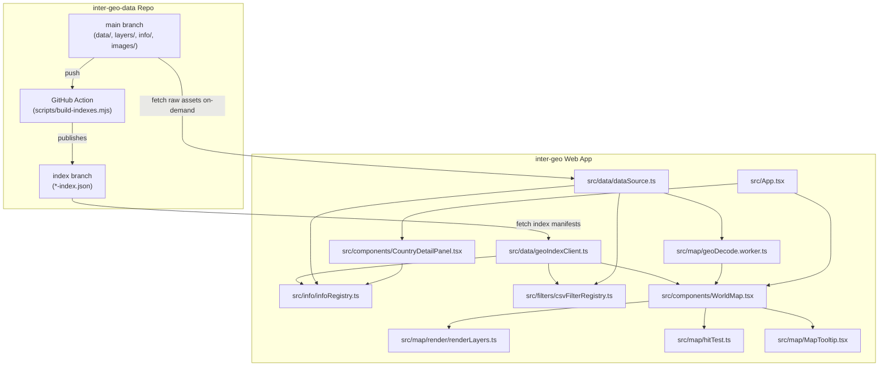

# Inter-Geo: AI Agent Onboarding

This document is the practical entry point for agents making changes to Inter-Geo. It describes the product, the boundaries between subsystems, where data comes from, and the invariants that are easy to break. Read the sections relevant to the task before editing. Follow current source code when this document and implementation disagree, then update this document if the architecture has changed.

## Project at a glance

Inter-Geo is an interactive world map for exploring geographic clues used in GeoGuessr-style location identification. Users pan and zoom across a Canvas map, inspect countries and administrative divisions, turn map layers on and off, and open Markdown information cards attached to map objects.

The system uses a **decoupled multi-repository architecture**:

- **Frontend App (`inter-geo`)**: A pure React, TypeScript, and Vite single-page application. It contains no heavy GIS binaries, CSV datasets, or Markdown content in its repository. The `public/` directory contains only essential web assets (e.g. `globe.svg`).
- **Data & Content Repository (`inter-geo-data`)**: A dedicated repository hosting all FlatGeobuf (`.fgb`) vector geometries, CSV layer datasets (`layers/`), Markdown dossier cards (`info/`), and media assets (`images/`).
- **Automated Remote Indexing (`index` branch)**: When changes are pushed to `main` on `inter-geo-data`, a GitHub Action runs `scripts/build-indexes.mjs` to parse directives, compute spatial/metadata indexes, and publish lightweight JSON manifests (`data-index.json`, `layers-index.json`, `info-targets.json`, `images-index.json`, `index.json`) onto an orphan `index` branch.
- **Client Dynamic Fetching**: The frontend fetches indexes from the `index` branch via `src/data/geoIndexClient.ts` and fetches raw assets on-demand from `main` via `src/data/dataSource.ts`.

The major runtime design split in `inter-geo` is:

- React owns durable interface state, panels, and header controls.
- `WorldMap` owns the interactive camera, pointer/gesture handling, asynchronous map-data loading, and coordination between rendering and hit testing.
- Canvas renderer and hit tester operate on shared geometry and visibility state.
- Dynamic indexes are retrieved once and cached in-memory; FGB geometries, full Markdown bodies, and CSV filter rows are loaded strictly on-demand.

## Repository map

### 1. Frontend Web App (`/home/harvey/inter-geo`)

| Path | Responsibility |
| --- | --- |
| `src/App.tsx` | Top-level state, URL startup parsing, selected object, active filters, detail panel wiring, and map focus callbacks. |
| `src/components/WorldMap.tsx` | Canvas lifecycle, camera transform, pointer/touch/wheel gestures, selection, hover, LOD transitions, visible-layer calculation, and data loading coordination. |
| `src/components/Header.tsx` | App header, layer drawer trigger, and Infotip display mode selector. |
| `src/components/FilterBar.tsx` | Accordion-grouped layer selector (`fill-region`, `ext-object`, `global-label`, `area-label`), filter search, and activation. |
| `src/components/CountryDetailPanel.tsx`, `src/components/MarkdownInfoCard.tsx` | Selected-object panel, essay card pagination, and reactive info rendering. |
| `src/map/render/renderLayers.ts` | Canvas drawing routines for geography, labels, roads, and active data layers. |
| `src/map/hitTest.ts` | Pointer-to-object resolution. Must agree with renderer visibility and draw order. |
| `src/map/geo.ts` | Shared world projection, map coordinate dimensions, and geographic math. |
| `src/map/geoWorkerClient.ts`, `src/map/geoDecode.worker.ts` | Worker protocol and FlatGeobuf decoding/projection away from the UI thread. |
| `src/data/dataSource.ts` | Single source of truth for constructing remote asset URLs (`main` branch) and index URLs (`index` branch). |
| `src/data/geoIndexClient.ts` | In-memory cached HTTP client for remote indexes (`data-index.json`, `layers-index.json`, `info-targets.json`). |
| `src/info/infoRegistry.ts` | Target-to-card querying, priority ranking (0..139), and on-demand Markdown body fetching with caching and deduplication. |
| `src/info/infotipPreferences.ts` | Infotip hover display mode state and LocalStorage persistence (`first-item`, `tags-badges`, `card-titles`, `minimal`). |
| `src/filters/csvFilterRegistry.ts` | Registered CSV filter state, initial fast stubs, dynamic remote layer sync, and value lookups. |
| `src/filters/assignableRegions.ts` | Generic region-id normalizer (`XX::YY`, `XX-YY`, numeric padding, Taiwan power pole zones) and effective range parser. |
| `src/objects/objectId.ts` | Canonical object IDs, namespace formatting, and object alias helpers. |
| `vite.config.ts` | Streamlined standard Vite React build configuration without build-time index plugins. |
| `public/globe.svg` | Application favicon. |

### 2. Data & Assets Repository (`/home/harvey/inter-geo-data`)

| Path | Responsibility |
| --- | --- |
| `data/**/*.fgb` | Global and regional FlatGeobuf files (`data/COUNTRY.fgb`, `data/XX.fgb`, `data/XX/YY.fgb`, `data/XX-roads.fgb`). |
| `layers/*.csv` | Standardized CSV layer data files with header directives (`@type`, `@nameZh`, `@group`, etc.). |
| `info/*.md` | Markdown information dossiers with card-level headers (`# Title`, `- id: ...`, `- targets: ...`, `- priority: ...`). |
| `images/**/*` | Category-organized image assets (e.g. crossing signs, bollards, architecture). |
| `scripts/build-indexes.mjs` | Node.js script that parses all data, layers, info cards, and images to generate indexes. |
| `.github/workflows/generate-index.yml` | GitHub Action workflow triggered on push to `main` that publishes `dist-index/` to the `index` branch. |

## Where to start by task

| Task | Start with |
| --- | --- |
| Add or edit a Map Layer | `inter-geo-data/layers/*.csv`; push to `main` to trigger index rebuild. |
| Add or edit Markdown Info Cards | `inter-geo-data/info/*.md`; inspect metadata keys and targets. |
| Add or update FGB Geometry | `inter-geo-data/data/`; verify hierarchy matches `data/COUNTRY.fgb` or `data/XX/YY.fgb`. |
| Add or update Image Assets | `inter-geo-data/images/`; reference via `images/<category>/<file>`. |
| Change URL startup parameters | `src/App.tsx`, `src/components/WorldMap.tsx`, `docs/url-initial-state.md` |
| Change map camera, gestures, selection, or hover | `src/components/WorldMap.tsx`, then `src/map/hitTest.ts` and `src/map/render/renderLayers.ts` |
| Change map colors, outlines, labels, or layer drawing | `src/map/render/renderLayers.ts`, `src/map/theme.ts` |
| Change Layer UI grouping or selection | `src/components/FilterBar.tsx`, `src/filters/csvFilterRegistry.ts` |
| Change Infotip hover modes or card preview | `src/map/MapTooltip.tsx`, `src/info/infotipPreferences.ts`, `src/components/Header.tsx` |
| Change region ID normalization or matching | `src/filters/assignableRegions.ts`, `src/objects/objectId.ts` |
| Change index loading or remote endpoints | `src/data/dataSource.ts`, `src/data/geoIndexClient.ts` |

## Architecture and data flow



### State ownership

- `App.tsx` owns durable high-level state: selected country/subdivision/municipality/road, active filters, visible regional filters, and detail-panel width/expanded mode.
- `WorldMap.tsx` owns camera transforms, active pointer/touch tracking, hover targets, loaded path indexes, and animation frame scheduling. Hot-path pointer interactions avoid React state updates.
- `renderLayers.ts` draws the current visual state. `hitTest.ts` independently determines pointer-to-object picking; their visibility and order invariants must remain in sync.

## Geographic data lifecycle & unlimited hierarchy

1. **Root Sketch (`data/COUNTRY.fgb`)**: Loaded eagerly on startup to render world borders and L1 country polygons. Each feature has an ISO-2 code (e.g. `JP`, `US`, `TW`).
2. **Dynamic L2 Discovery**: `geoIndexClient.hasCountryL2Sync(iso2)` consults `data-index.json` to verify whether `data/${iso2}.fgb` exists before requesting it.
3. **Unlimited Hierarchy Recursion**: Whenever an FGB object `B` is hovered or selected within parent file `A.fgb`, `geoIndexClient.resolveSubdivisionFileSync(parentPath, childId)` resolves deeper paths such as `data/A/B.fgb` or `data/XX/YY.fgb`. This allows arbitrary subdivisions beyond two levels without hardcoded limits.
4. **External Objects (`XX-ZZ.fgb`)**: Non-boundary features (e.g. `data/XX-roads.fgb`) are separated from boundary geometry and streamed by workers when corresponding Ext Object layers are enabled.

## CSV layers and filter groups

Layers are authored as CSV files in `inter-geo-data/layers/*.csv`. Each file begins with comment directives:

```csv
// @id: driving-side
// @nameZh: 行駛方向 (左右行)
// @nameEn: Driving Side
// @shortBadge: 🚦 方向
// @group: fill-region
// @type: FillWithColor
// @default-color: #3b82f6
// @order: 8
// @descriptionZh: 全球各國道路通行方向制度分布
region-id,value,label
JP,Left,靠左
GB,Left,靠左
TW,Right,靠右
US,Right,靠右
```

### Layer Groups in `FilterBar.tsx`

1. **Fill Region With Color (`group: fill-region`)**:
   - Single-select radio buttons with a **Base** option.
   - Used for global region fills: Base, Google Street View Coverage, Driving Side, Road Markings.
2. **Ext Object (`group: ext-object`)**:
   - Multi-select checkboxes for non-region geometries (e.g. national highway networks, Taiwan power-pole grid coordinates).
3. **Global Label (`group: global-label`)**:
   - Multi-select pill buttons for international text/image annotations (flags, calling codes, ccTLDs, currencies).
4. **Area Label (`group: area-label`)**:
   - Multi-select pill buttons for regional linguistic/symbolic clues (street name words, South Asian scripts, pedestrian signs).

### Double-Color Road Markings

Road edge lines and center dividing lines are standardized as `#border:#centerLine` (e.g. `#f1f5f9:#f59e0b` for white edge and yellow center). The renderer detects the colon delimiter and applies dual-stroke styling.

### Generic Region Normalization

`src/filters/assignableRegions.ts` provides `normalizeRegionKeys(rawId, defaultIso2)`:
- Maps `JP::26` $\leftrightarrow$ `JP-26` $\leftrightarrow$ `26`.
- Automatically handles numeric padding: `JP-01` $\leftrightarrow$ `JP-1` $\leftrightarrow$ `01` $\leftrightarrow$ `1`.
- Automatically namespaces country shortcuts: `CA` with `targetIso2 = 'US'` $\rightarrow$ `['CA', 'US::CA', 'US-CA']`.
- Handles special grids: `TP-H` $\rightarrow$ `['TP-H', 'TW::TP-H', 'TW-TP-H', 'H']`.
- Works generically for any country globally without hardcoded state tables.

## Markdown information cards & Infotip preferences

Cards are authored in `inter-geo-data/info/*.md` with `# Heading` titles and bulleted metadata:

```md
# Japan
- id: country-jp
- targets: JP
- priority: 1
- icon: 🇯🇵
- accent: #38bdf8
- tags: 東亞, 靠左行駛, 官方街景
- type: country
- display: true

- **關鍵線索**: 靠左行駛 (Left Drive) + Low Cam 低相機高度。
- **車牌**: 白底綠字（普通車）或黃底黑字（輕型車）。
```

### Ordering & Retrieval

- **Strict Priority**: Cards are sorted strictly by `priority` from `0` to `139` ascending (default `140`). Equal priorities preserve discovery order.
- **On-Demand Fetching**: `infoRegistry.ts` queries the remote `info-targets.json` index instantly, then fetches only the required `.md` file on-demand, caching and deduplicating in-flight network requests.

### Infotip Display Modes

The map hover tooltip supports 4 user-selectable modes via `src/info/infotipPreferences.ts`:
1. 💡 **線索重點 (`first-item`)**: Preview the first bullet clue of the highest-priority card.
2. 🏷️ **特徵膠囊 (`tags-badges`)**: Compact pill badges showing tags, driving side, and coverage.
3. 📋 **線索清單 (`card-titles`)**: List of all relevant topic card titles.
4. ⚡ **極簡名稱 (`minimal`)**: Country/subdivision name, flag, and code only.

Users can toggle modes via the header button; preferences persist in `localStorage`.

## Development workflow

```sh
npm run dev       # Starts Vite dev server (0.0.0.0:5173)
npm run lint      # Runs ESLint
npm run build     # Runs tsc -b and vite build (< 1 second)
npm run preview   # Serves local production build
```

When authoring or modifying data, make changes in `/home/harvey/inter-geo-data`, commit and push to `main`. The GitHub Action will automatically rebuild and deploy the `index` branch, which the frontend will consume immediately.
