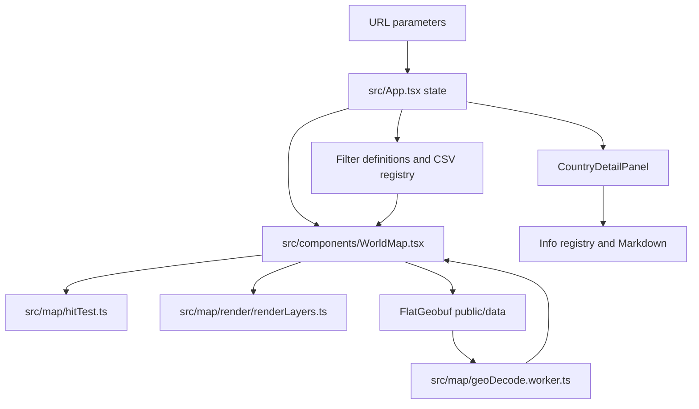

# Inter-Geo: AI Agent Onboarding

## What this project does

Inter-Geo is an interactive world map for exploring geographic clues used in GeoGuessr-style location identification. Users pan and zoom across a Canvas map, select countries and administrative regions, enable geographic layers, and open Markdown info cards associated with map objects.

The frontend is a static-data application built with React, TypeScript, and Vite. It uses Canvas 2D for map rendering and FlatGeobuf files for vector geography. There is no application backend required for normal map use; Vite serves the app and its public data files.

## Where to start for common tasks

| Task | Start here |
| --- | --- |
| Change app-level state, URL startup behavior, or connect panels | `src/App.tsx` |
| Change map gestures, initialization, selection, loading, or camera behavior | `src/components/WorldMap.tsx` |
| Change map appearance or layer drawing | `src/map/render/renderLayers.ts`, `src/map/theme.ts` |
| Change which map feature wins pointer hit testing | `src/map/hitTest.ts` |
| Change filter selector UI | `src/components/FilterBar.tsx` |
| Change selected-object information panel | `src/components/CountryDetailPanel.tsx`, `src/components/MarkdownInfoCard.tsx` |
| Add or edit info-card content | `public/info/*.md` |
| Add or edit CSV map layers | `public/layers/*.csv` |
| Change country, L2, L3, or road metadata | `src/data/`, especially the relevant manifest or registry |
| Change vector conversion or data generation | `scripts/`, `src/map/geoDecode.worker.ts`, `src/map/geoWorkerClient.ts` |
| Change build-time content indexing or public-file watching | `vite.config.ts` |

Useful references:

- `docs/project-overview.md`: product and architecture overview.
- `docs/vector-data-pipeline.md`: how geographic data is generated and decoded.
- `docs/info-content.md`: Markdown info-card syntax and images.
- `docs/url-initial-state.md`: startup URL parameters and precedence.
- `docs/optimization-report.md`: known map performance work.

## Main runtime flow

`App.tsx` owns durable UI state: selected object, active filters, and panel configuration. It passes this state and callbacks to `WorldMap`. `WorldMap` owns the Canvas camera and high-frequency pointer/gesture work, using refs to avoid routing every frame through React state. It calls selection callbacks only when a map interaction changes the selected object. Rendering and hit testing are separate modules and should be updated together when a new interactive map feature is added.

## Geographic data flow

1. **Source and generated data:** `public/data/` contains the runtime FlatGeobuf files. Manifests and dataset metadata live in `src/data/`. Generation and conversion scripts live in `scripts/`; check the relevant script and manifest before changing a dataset.
2. **Startup:** `WorldMap` loads the L1 country file. L2 country files are decoded in background workers. Road and L3 data load on demand according to viewport, selected parent, and active layer state.
3. **Decode:** `src/map/geoWorkerClient.ts` sends requests to `src/map/geoDecode.worker.ts`. The worker fetches and decodes FGB data, projects coordinates, and returns path strings, bounds, and (where applicable) centroids.
4. **Prepare:** The main thread creates `Path2D` objects and indexes them by country or parent region.
5. **Render and interact:** `renderLayers.ts` draws visible paths to Canvas. `hitTest.ts` resolves pointer hits using the same loaded geometry and active layer state.

Projection constants and the shared Web Mercator projection are in `src/map/geo.ts`. L1/L2/L3 manifests are in `src/data/`; roads have a separate manifest and metadata registry. LOD behavior is defined in `src/types/lod.ts` and used by `WorldMap` and renderers.

## Info-card data flow

1. Author content in `public/info/*.md`. Each top-level `#` heading is one card. Metadata is written as list entries directly below the heading, such as `- id: ...`, `- targets: ...`, `- tags: ...`, `- image: ...`, or `- display: true`.
2. During Vite startup/build, the content-index plugin in `vite.config.ts` scans Markdown and emits lightweight stubs containing IDs, targets, titles, tags, and source paths. This lets the app find candidate cards without fetching every full article.
3. `src/info/infoRegistry.ts` indexes stubs by target, ranks matches for the selected object, fetches the matching Markdown file from `/info/` using Vite's `BASE_URL`, and caches parsed cards.
4. `src/info/infoParser.ts` turns each `#` section and its metadata/body into an `InfoCard`. `CountryDetailPanel` builds the query from the currently selected map object, and `MarkdownInfoCard` renders the matching cards.

Keep the build-time stub parser in `vite.config.ts` consistent with the runtime parser in `src/info/infoParser.ts`. If metadata syntax or matching rules change, update both sides. Store local public images under `public/` and reference them with a root-relative public path; external HTTP(S) image URLs are also supported.

## CSV layer data flow

1. Author CSV layers in `public/layers/*.csv`. Header comments use directives such as `// @id: ...`, `// @type: Text`, `// @effectiveRange: Nationwide:JP`, and `// @focusTarget: JP::47`.
2. The Vite content-index plugin scans public CSV headers and creates `virtual:csv-filter-index` stubs. It also watches these files in dev mode and invalidates the index after edits.
3. `src/filters/csvFilterParser.ts` parses CSV metadata and rows. `src/filters/assignableRegions.ts` defines valid IDs and aliases for supported effective ranges.
4. `src/filters/csvFilterRegistry.ts` exposes lightweight filter metadata synchronously and fetches full CSV content from `/layers/` on demand using `BASE_URL`.
5. `FilterBar` activates filters through `App.tsx`; `WorldMap` loads data and passes active filters into `renderLayers.ts` for drawing. Nationwide definitions and built-in filters are combined in `src/data/nationwideFilters.ts`.

For a new regional CSV layer, provide `@focusTarget` when activating the layer should guide the map to a representative object. Reuse the internal namespace format, for example `JP::47`. Update the relevant rendering path if the CSV type requires custom drawing; parser registration alone does not implement a renderer.

## URL behavior

- `?target=JP` opens the country object; `?target=JP::47` opens a namespaced subdivision object.
- `target` may instead contain a recognized layer ID, such as `area-codes-JP` or `indiaScripts`.
- If `target` is present, camera parameters are ignored during initialization. Without `target`, `lat`, `lon`, and `ratio` initialize the map view.
- Camera synchronization replaces the query with `lat`, `lon`, and `ratio` via `history.replaceState`; it does not add browser-history entries.
- A full page reload clears the query before initialization. Opening a shared URL as a normal navigation still consumes its parameters.

## Development and verification

- `npm run dev`: start Vite on port 5173.
- `npm run build`: run TypeScript project checks and create a production build.
- `npm run lint`: run ESLint.

When changing public content loading, verify that generated stub paths are `/info/...` or `/layers/...` and that runtime fetches prefix them with `import.meta.env.BASE_URL` plus a slash. This project is deployed below `/inter-geo`, so paths that work at `/` may still be wrong in production if the base prefix is omitted or concatenated without a slash.

## Maintenance guidance

- Keep Canvas hot paths out of avoidable React rerenders; pointer movement can happen every animation frame.
- Treat render visibility and hit-test eligibility as related behavior. A feature that is drawn but cannot be hit (or is hit but not visible) is usually a bug.
- Active layers may need to expand their target LOD even when there is no pointer hover. Check `getActiveLayerHoverTargets` and `getExpandedL2Countries` in `WorldMap.tsx` when a layer only appears after hovering.
- Avoid assuming worldwide data is complete. Coverage varies by country, administrative level, and layer.
- Preserve unrelated working-tree changes when editing; the workspace may contain changes from multiple ongoing tasks.
