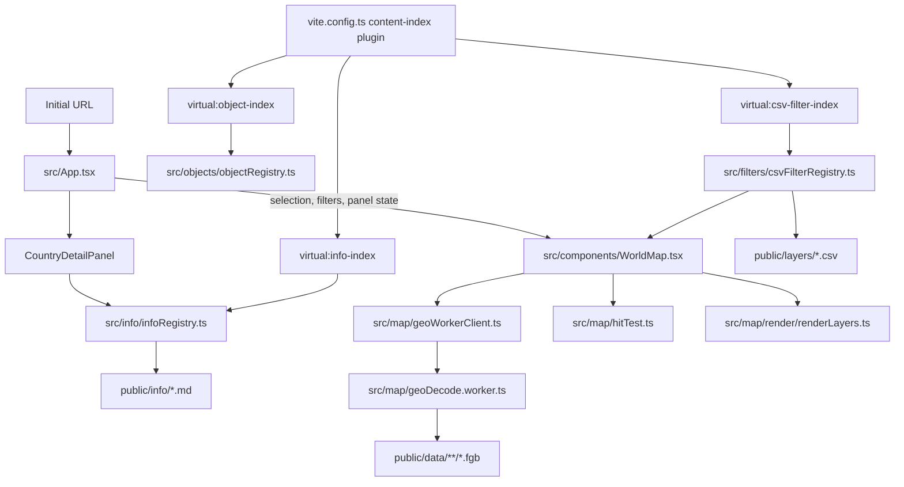

# Inter-Geo: AI Agent Onboarding

This document is the practical entry point for agents making changes to Inter-Geo. It describes the product, the boundaries between subsystems, where data comes from, and the invariants that are easy to break. Read the sections relevant to the task before editing. Follow current source code when this document and implementation disagree, then update this document if the architecture has changed.

## Project at a glance

Inter-Geo is an interactive world map for exploring geographic clues used in GeoGuessr-style location identification. Users pan and zoom across a Canvas map, inspect countries and administrative divisions, turn map layers on and off, and open Markdown information cards attached to map objects.

The application is a static-data frontend built with React, TypeScript, and Vite. Normal map use does not require an application server or database. Vite serves the frontend during development; production data and assets are deployed as public static files. Geography is stored primarily as FlatGeobuf (`.fgb`) vector files.

The major design split is:

- React owns durable interface state and panel composition.
- `WorldMap` owns the interactive camera, pointer/gesture handling, asynchronous map-data loading, and coordination between rendering and hit testing.
- Canvas renderer and hit tester operate on shared geometry and visibility state.
- Static Markdown/CSV files are indexed at build time, then their full contents are fetched only when needed.

## Repository map

| Path | Responsibility |
| --- | --- |
| `src/App.tsx` | Top-level state, URL startup parsing, selected object, active filters, detail panel wiring, and map focus callbacks. |
| `src/components/WorldMap.tsx` | Canvas lifecycle, camera transform, pointer/touch/wheel gestures, selection, hover, LOD transitions, visible-layer calculation, and data loading coordination. |
| `src/map/render/renderLayers.ts` | Canvas drawing routines for geography, labels, roads, and active data layers. |
| `src/map/hitTest.ts` | Pointer-to-object resolution. It should agree with renderer visibility and draw order. |
| `src/map/geo.ts` | Shared world projection, map coordinate dimensions, and geographic math. |
| `src/map/geoWorkerClient.ts`, `src/map/geoDecode.worker.ts`, `src/map/geoDecodeTypes.ts` | Worker protocol and FlatGeobuf decoding/projection away from the UI thread. |
| `src/map/types.ts`, `src/types/geo.ts`, `src/types/lod.ts` | Shared render, geography, and administrative-level types. |
| `src/map/MapControls.tsx`, `src/map/MapLegend.tsx`, `src/map/MapTooltip.tsx` | Map controls and overlays. |
| `src/components/FilterBar.tsx` | Filter discovery, search, activation, and filter UI. |
| `src/data/filters.ts` | Built-in/global filter definitions. |
| `src/data/nationwideFilters.ts` | Nationwide filter definitions and per-country layer behavior. |
| `src/filters/` | CSV layer parsing, assignable IDs, metadata registry, lazy data loading, and value lookup. |
| `src/data/l2Manifest.ts`, `src/data/l3Manifest.ts`, `src/data/roadsManifest.ts` | Generated metadata describing available vector files and their coverage. |
| `src/data/countries.ts`, `src/data/roadsMeta.ts`, `src/data/taiwanPowerPoles.ts` | Country metadata, road display metadata, and Taiwan power-grid zones. |
| `src/objects/` | Canonical object IDs, object types, and the generated object catalog API. |
| `src/info/` | Info Markdown parser, image URL resolution, and target-to-card registry. |
| `src/components/CountryDetailPanel.tsx`, `src/components/MarkdownInfoCard.tsx`, `src/components/L3ChildPicker.tsx` | Selected-object panel, info-card rendering, and child administrative-area picker. |
| `public/data/` | Runtime FlatGeobuf files. This is generated/static data, not hand-edited application logic. |
| `public/layers/` | CSV filter/layer content. |
| `public/info/` | Markdown information cards. |
| `public/images/` | Local images used by public content. |
| `scripts/` | Data conversion, manifest/object-catalog generation, and data-specific transformation utilities. |
| `vite.config.ts` | Vite setup and build-time virtual indexes for objects, Markdown info, and CSV layers. |
| `docs/url-initial-state.md` | Detailed startup URL parameter contract. |

The source tree is authoritative for runtime behavior. Manifests and public data may be generated; inspect their generator before changing generated files.

## Where to start by task

| Task | Start with |
| --- | --- |
| Add or change a URL startup parameter | `src/App.tsx`, `src/components/WorldMap.tsx`, `docs/url-initial-state.md` |
| Change map camera, pan/zoom, touch gestures, selection, or hover | `src/components/WorldMap.tsx`, then `src/map/hitTest.ts` and `src/map/render/renderLayers.ts` as needed |
| Change what wins when map shapes overlap | `src/map/hitTest.ts`; compare its eligibility and ordering against `renderLayers.ts` |
| Change map colors, outlines, labels, or layer drawing | `src/map/render/renderLayers.ts`, `src/map/theme.ts` |
| Add a new map layer | `public/layers/`, `src/filters/`, `src/data/nationwideFilters.ts` or `src/data/filters.ts`, `FilterBar.tsx`, then renderer and hit test if it is spatial/interactive |
| Change regional layer visibility or target LOD expansion | `WorldMap.tsx` functions around active-layer hover targets and expanded L2 countries; then renderer/hit test |
| Change info-card matching or object naming | `src/objects/objectId.ts`, `src/info/infoRegistry.ts`, `src/objects/` |
| Add/edit info content or images | `public/info/*.md`, optionally `public/images/`; check `infoParser.ts` and `MarkdownInfoCard.tsx` for supported syntax |
| Change info panel width, full-width behavior, or selection details | `src/App.tsx`, `src/components/CountryDetailPanel.tsx`, relevant CSS |
| Change vector geometry generation | Relevant `scripts/*.mjs`, the corresponding manifest, and `public/data/`; inspect the worker protocol if output format changes |
| Change CSV/Markdown/object discovery in dev/build | `vite.config.ts`, associated registry, and virtual module declaration files |
| Change mobile browser/keyboard layout | `src/App.tsx`, `src/components/Header.tsx`, `src/index.css`, `src/App.css`, and map controls as relevant |

## Runtime and data flow



### State ownership

`App.tsx` owns state that affects the rest of the interface: selected country/subdivision/municipality/road, active filters, visible regional filters, detail-panel width/full-width mode, and road toggles. It passes values and callbacks down to `WorldMap` and the selected-object panel.

`WorldMap.tsx` owns high-frequency or geometry-oriented state: camera transform, active pointers, drag/pinch state, hover references, loaded path indexes, visible viewport state, and animation scheduling. Many of these are refs so pointer movement does not force React to render on every frame. Do not move hot-path values into React state without a clear reason and performance check.

`renderLayers.ts` draws the current state. `hitTest.ts` independently decides which geographic object receives a pointer interaction. For a feature to behave correctly it must have consistent visibility, draw order, and hit eligibility. Fixing only one side often creates invisible clickable shapes or visible shapes that cannot be selected.

### Geographic data lifecycle

1. `public/data/` contains runtime FGB files. `src/data/*Manifest.ts` describes files, parent relationships, counts, and bounding boxes used to avoid loading the world up front.
2. On startup, `WorldMap` loads L1 country geometry so the map appears quickly. L2 country data is streamed/decoded in workers; L3 partitions and road data are loaded on demand based on selected/hovered targets, active layers, and viewport.
3. `geoWorkerClient.ts` communicates with `geoDecode.worker.ts`. The worker fetches and decodes FGB, validates geometries, projects geographic coordinates into the application’s shared map coordinates, and returns path data/bounds/metadata.
4. The main thread creates `Path2D` objects and indexes paths by country or administrative parent for rendering and hit testing.
5. The Canvas is redrawn through scheduled animation frames. Keep geometry decode and large synchronous loops off the pointer-move hot path.

The projection and canvas coordinate model live in `src/map/geo.ts`. LOD types are in `src/types/lod.ts`. L1 is country-level, L2 is the first administrative subdivision, and L3 is the next subdivision level (the names in data sources may call these Admin-1/Admin-2).

To change vector datasets, locate the matching generator first: `build:data`, `build:l2`, `build:l3`, or `build:roads` in `package.json` points to the script entry. Some country datasets have dedicated merge/repair scripts. Generated manifests and FGB output must describe the same geometry and path layout. Do not hand-edit a generated manifest unless the generator is also corrected or the file is intentionally maintained as source.

### Object IDs and namespaces

Object IDs are a cross-cutting contract used by selection, info-card targets, layer focus targets, and URL initialization. `src/objects/objectId.ts` is the canonical formatter/normalizer; `scripts/build-object-index.mjs` contains equivalent Node-side rules because Node cannot import the TypeScript module directly.

- A country root is its ISO-2 code, for example `JP`.
- A child object uses `PARENT::LOCAL`, for example `JP::47`.
- Numeric subdivision IDs may have padded and unpadded aliases, such as `JP::1` and `JP::01`.
- Dataset codes like `JP-01` and names can also be registered aliases; do not assume every consumer stores the same raw spelling.
- Road and grid objects have their own canonical ID helpers (`roadObjectId`, `gridObjectId`). Avoid inventing another formatting rule in a UI component.

`src/objects/objectRegistry.ts` loads the Vite-generated `virtual:object-index` and provides `getObject`, `getCountryRoot`, `objectsByParent`, and `isCountryId`. If a new object class or alias should be addressable, update the index builder and canonical ID helpers, not just one matching call site.

## Markdown information cards

Author content in `public/info/*.md`. Each top-level `#` heading begins one card; a file can contain many cards. Do not use `---` as a separator between cards. Metadata belongs in simple bullet entries immediately after the heading, followed by body bullets/content.

Example:

```md
# Okinawa
- id: japan-okinawa
- targets: JP::47
- icon: 🌴
- accent: #fbbf24
- priority: 5
- display: false
- image: https://example.com/okinawa.jpg
- imageSize: banner
- imagePosition: top
- imageAlt: Okinawa coastline

- **辨識線索**: 內文可以使用 **粗體**、*斜體*、`code` 與連結。
- **地形**: 主要島嶼與聚落沿海分布。
  - 縮排項目會變成該條目的子項目。
```

Supported metadata is parsed by both `src/info/infoParser.ts` (runtime full-content parser) and `vite.config.ts` (build-time lightweight index parser). Relevant keys include `id`, `title`, `target`/`targets`, `icon`, `accent`/`color`, `tags`, `type`, `priority`, `comparison`, `image`, `imageSize`, `imagePosition`, `imageAlt`, and `display`. Keep both parsers aligned when adding or changing metadata. The project parser is YAML-like rather than a general YAML implementation; use simple scalar values or comma/bracket-separated lists.

`display: true` makes the card body expanded initially; `display: false` starts it collapsed. The user can toggle each card by clicking the card surface/title. `targets` may be one or more canonical object IDs/aliases. Comparison cards can use multiple targets with `type: comparison` or comparison tags/metadata. Priority affects which candidate card appears earlier when several match.

Inline images support Markdown form `` and the extended size form ``. `size` may be `sm`, `md`, `lg`, `xl`, `banner`/`full`, a pixel number such as `120`, or dimensions such as `160x90`. `banner` is full card content width with a bounded height; other tokens are compact inline/side images. `imageSize` applies to the card-level metadata image. `imagePosition` supports the card image placement such as `left`, `right`, or `top`. `src/info/imageUrl.ts` resolves local public paths and external HTTP(S) image URLs. Local public assets should be referenced with public paths and external images should use stable public URLs (for example an S3 object URL).

Build-time info indexing creates small stubs with IDs, target keys, metadata, and source paths so the app can find matching cards without fetching all Markdown bodies. `infoRegistry.ts` ranks candidate matches, fetches the source file on demand, deduplicates concurrent fetches, and caches parsed cards. `CountryDetailPanel.tsx` creates a query from the selected object; `MarkdownInfoCard.tsx` renders the results. If target matching changes, inspect `src/info/infoRegistry.ts`, `src/objects/objectId.ts`, and `scripts/build-object-index.mjs` together.

## CSV layers and filters

Author CSV layers in `public/layers/*.csv`. A filter file can start with comment directives; the first non-comment content is CSV data. For example:

```csv
// @id: area-codes-JP
// @nameZh: 日本區碼
// @nameEn: Japan Area Codes
// @shortBadge: ☎️ 區碼
// @effectiveRange: Nationwide:JP
// @type: Text
// @loadedTiming: on-demand
// @focusTarget: JP::47
region-id,value,label
JP-47,098,沖繩
```

Important directives include `@id`, `@nameZh`, `@nameEn`, `@shortBadge`, `@accentColor`, `@descriptionZh`, `@effectiveRange`, `@type`, `@loadedTiming`, `@order`, and `@focusTarget`.

- `effectiveRange` defines which region IDs are valid and how aliases normalize. Supported lists are implemented in `src/filters/assignableRegions.ts`; do not assume an arbitrary country namespace is assignable without checking that module and the object catalog.
- `type` currently distinguishes `FillColor`, `Text`, `Image`, and `Special`. A new type still needs UI behavior and a renderer; adding metadata alone does not draw a layer.
- `loadedTiming` is `init` for eager loading or `on-demand` for fetch on activation/lookup. Most layer data should remain on demand.
- `focusTarget` is an internal object ID used to guide the map when the layer is activated. It can target a country or a namespaced child object. Regional layers that affect an area not under the current hover must also drive the active-layer hover/LOD target logic in `WorldMap`.
- Rows use region ID, value, and optionally label. The parser validates IDs against the selected effective range and builds normalized lookup maps.

`vite.config.ts` scans CSV header directives into `virtual:csv-filter-index`. `src/filters/csvFilterRegistry.ts` turns these stubs into filter definitions, fetches complete CSV data as required, parses it through `csvFilterParser.ts`, and exposes lookups. `FilterBar.tsx` and `App.tsx` manage activation; `WorldMap.tsx` determines geographic visibility and LOD expansion; `renderLayers.ts` draws active values. `src/data/nationwideFilters.ts` holds hand-defined nationwide filters, while `src/data/filters.ts` holds built-in/global filter definitions.

The old `filter-reg.csv` registry path is not part of the current runtime architecture. Do not add new metadata there; use each CSV file’s header directives.

## URL initialization and synchronization

The URL contract is documented in [`url-initial-state.md`](url-initial-state.md). The short version:

1. `target` is the highest-priority initialization parameter. It can identify a geographic object (`JP`, `JP::47`, or another supported object level) or a recognized layer/filter ID. Only one `target` is used.
2. If `target` is absent, `lat`, `lon`, and `ratio` can initialize the camera. These are the second-priority initialization options.
3. Camera movement synchronizes only camera parameters back to the address using `history.replaceState`, so panning does not create many Back-button entries and the first-priority `target` is not copied into the synchronized URL.
4. A full page reload clears the current query before startup. A normal navigation to a shared URL still consumes its query on initial load.

Treat changes to precedence or URL cleanup as compatibility changes. Update both `App.tsx`, map initialization/focus logic, and the URL document. Object-target parsing should use the canonical namespace conventions.

## LOD, hover, selection, and layer visibility invariants

- Geographic display is progressive. The app uses L1 countries, L2 subdivisions, and L3 child subdivisions; view scale alone is not the only reason a child level may be available.
- Hover can reveal a child level when the hovered object occupies enough screen area. Selection is independent: a selected object stays highlighted, and its detail panel can keep related child geometry available.
- Active regional layers can target countries outside the pointer’s current hover. Their target regions may need L2/L3 geometry expanded so that the layer is visible. Look for `getActiveLayerHoverTargets`, `getExpandedL2Countries`, and the viewport synchronization code in `WorldMap.tsx`.
- Click selection must remain possible at high zoom even when the parent object was not separately selected first. When changing the hierarchy, validate direct child hover/click as well as parent-to-child navigation.
- Canvas draw order, LOD expansion, and hit-test eligibility need to stay aligned. If an object appears to flicker, inspect hover transitions and scheduled recomputations as well as drawing.
- Nationwide geometry and some special datasets may need custom LOD behavior. Do not globally weaken LOD filtering to fix one dataset; identify the dataset-specific constraint and apply it at the correct layer.
- Hover and pointer move are hot paths. Reuse cached/indexed paths and bounding boxes, schedule work via existing animation-frame mechanisms, and avoid scanning all geometries or triggering React state updates for every raw pointer event.

## Build-time virtual indexes and public paths

The content-index plugin in `vite.config.ts` builds three virtual modules:

- `virtual:object-index`: produced by `scripts/build-object-index.mjs`, built from geography/manifest data and used by `src/objects/objectRegistry.ts`.
- `virtual:info-index`: lightweight Markdown card stubs extracted from `public/info/`.
- `virtual:csv-filter-index`: lightweight CSV metadata extracted from `public/layers/`.

In dev mode the plugin watches public info, layers, and data, invalidates the relevant virtual module, and reloads the page. If a new input source should affect an index, update the index builder and watcher invalidation paths. `src/virtual-info.d.ts` and other virtual module declarations provide TypeScript types for virtual imports.

The configured deployment base is `/inter-geo`. For runtime fetches, compose URLs using `import.meta.env.BASE_URL` and normalize the slash boundary (see the registries). A raw `/info/...` or `/data/...` URL may work at the domain root but fail when hosted below the configured base. Also inspect any generated `file` field: manifests sometimes store root-relative paths, so consumers must apply `BASE_URL` consistently.

## Development workflow

Requirements are defined by `package.json`; use the project’s installed package manager/dependencies rather than introducing an alternative toolchain.

```sh
npm run dev       # Vite development server (0.0.0.0:5173)
npm run lint      # ESLint across the project
npm run build     # TypeScript project build followed by production Vite build
npm run preview   # Serve the production build locally
```

Data scripts include `npm run build:data`, `npm run build:l2`, `npm run build:l3`, and `npm run build:roads`. These can generate or overwrite sizeable geographic artifacts; inspect the script and expected inputs before running them. `npm run fgb:view` is a data inspection helper.

When asked to modify code, run the relevant checks and report their results. Do not run data generation for a UI-only change. For map/data changes, a successful TypeScript build does not prove that LOD, visual stacking, or hit testing behaves correctly; manually inspect the affected scenario if a runtime preview is available. Keep unrelated working-tree changes intact. Do not commit or push unless explicitly asked.

## Debugging checklist

When something does not appear or select correctly, trace the pipeline in this order:

1. **Is the input registered?** For Markdown/CSV inspect the header syntax and Vite virtual index. For geometry inspect the manifest, FGB path, and object catalog.
2. **Was the data loaded?** Check the relevant on-demand loader, fetch URL including `BASE_URL`, worker response, and loaded path index.
3. **Is it eligible at the current view?** Check viewport filtering, active layer target regions, LOD expansion, and selected/hovered parent state.
4. **Is it drawn?** Check `renderLayers.ts`, layer activation IDs, draw order, and Canvas clipping/transform.
5. **Can it be hit?** Check `hitTest.ts` ordering, geometry references, and whether the renderer and hit tester received equivalent visibility context.
6. **Does selection resolve to the right details?** Follow the callback to `App.tsx` and the selected-object query to `CountryDetailPanel`/`infoRegistry`.
7. **Does it survive deployment paths?** Verify runtime fetches include `BASE_URL` and that external image URLs are publicly reachable.

## Maintenance notes

- Keep this guide aligned with current code. Do not link to removed or obsolete architecture documents.
- Keep paired parsers aligned: Markdown metadata is parsed once at build time and again at runtime; object ID rules are used in browser TypeScript and Node build tooling.
- Keep generated artifacts reproducible. Prefer modifying their source scripts/manifests and regenerating when authorized.
- Avoid broad refactors in `WorldMap.tsx` while fixing a localized feature; it coordinates many behaviors and several callbacks depend on refs for performance.
- Preserve existing user changes in the working tree. Inspect `git status` before cleanup or broad formatting.
