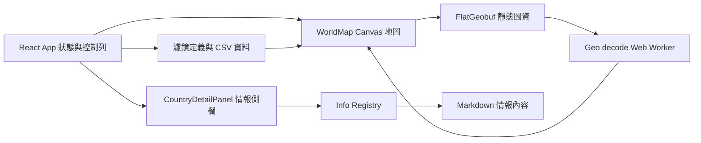

# Inter-Geo 專案報告

## 專案定位

Inter-Geo 是一個以 GeoGuessr 線索判讀為主要使用情境的互動式地理資訊地圖。使用者可以從全球國家逐步放大至一級行政區，查看道路與區域特徵，並在情報側欄閱讀與目前地圖對象相關的資料。它採用 React、TypeScript、Vite 和 Canvas 2D，在瀏覽器端呈現靜態向量圖資，不需要專用地圖伺服器。

本報告依照目前程式結構撰寫。README 與部分較早期文件仍保留舊元件名稱或舊載入方式；下文以 `src/` 現行實作為準。圖資處理細節另見[向量圖資處理文件](vector-data-pipeline.md)，效能待辦見[優化待辦](optimization-report.md)。

## 使用者可做的事

- 瀏覽世界地圖，平移、縮放並跨越日期變更線連續移動。
- 選取國家或一級行政區，開啟對應情報卡；放大後可查看 L2 行政區。L3 子行政區圖資可按父區域載入，但 L3 縮放門檻預設為關閉。
- 啟用國際、區域或全國濾鏡，以顏色、文字、圖示等方式呈現國家或區域特徵。道路資料也透過全國道路濾鏡啟用，視窗內才載入相關路網。
- 點選道路、台電電網區域等可辨識圖層，查看特定對象的資料。
- 使用情報卡中的麵包屑在國家、行政區與子區域脈絡間移動；按 Escape 可關閉側欄或彈窗。

實際可用圖資與互動會依各層資料覆蓋範圍而異；專案內的行政區清單、道路資料與敘述內容不代表每個國家都有同等完整度。

## 系統架構

### 前端與地圖

`src/main.tsx` 掛載 React 應用，`src/App.tsx` 管理目前濾鏡、選取對象、道路顯示與側欄等應用狀態。地圖主體在 `src/components/WorldMap.tsx`，透過 `src/map/geo.ts` 的 D3 Geo Web Mercator 投影將地理圖徵轉成地圖座標，再由 `src/map/render/renderLayers.ts` 在單一 Canvas 2D 上分層繪製。地圖互動的命中判定集中於 `src/map/hitTest.ts`。

Canvas 繪圖與 React 介面各自負責不同工作：地圖拖曳、縮放和 hover 主要更新地圖參照狀態並排入下一個動畫影格；選取結果、控制列與情報側欄則由 React 呈現。地圖包含 L1 國家、L2 一級行政區、L3 子行政區及道路等圖層。L1 圖資為 `public/data/countries-110m.fgb`；L2 圖資分國存放；L3 圖資依父區域切包；道路亦依國家分包。

### 圖資解碼與載入

FlatGeobuf（FGB）是前端使用的二進位向量格式。`src/map/geoWorkerClient.ts` 將解碼工作交給 `src/map/geoDecode.worker.ts`：worker 抓取 FGB、驗證幾何、投影成路徑字串並計算包圍盒；L2 另外計算中心點與合併外框。主執行緒再將路徑建為 `Path2D`，供繪圖和點擊判定使用。

目前啟動流程會先載入 L1，並在背景串流解碼全球 L2 圖資；道路與 L3 則按目前視窗、啟用狀態或選取的父區域載入。L3 預設門檻為 `Infinity`，因此一般狀態不會自動切入 L3。Manifest 提供各包的空間範圍與索引資訊，協助判斷哪些資料可能進入視窗。

### 濾鏡與內容索引

濾鏡定義分布於 `src/data/`，其資料可由 `public/layers/*.csv` 提供。`src/filters/csvFilterParser.ts` 負責解析 CSV，`csvFilterRegistry.ts` 管理定義與按需資料載入；全國濾鏡由 `src/data/nationwideFilters.ts` 組合，包含特定國家的道路濾鏡。

情報內容以 `public/info/*.md` 編寫。建置設定 `vite.config.ts` 會建立輕量 Info 索引（對象、標題、標籤、來源等），而完整 Markdown 內文在需要時才由 `src/info/infoRegistry.ts` 讀取、解析及快取。`CountryDetailPanel` 根據所選國家、行政區、子區域、道路或電網區域產生查詢，再由 `MarkdownInfoCard` 顯示匹配內容。這讓長篇內容與地圖資料保持分離，也便於新增或修訂情報文章。

Info 卡片的主圖與內文行內圖都可使用外部 HTTP(S) 圖片網址，例如 S3 或公開 CDN；本機 `public/` 圖片路徑也會依部署 base path 解析。語法與範例見[Info 內容與圖片](info-content.md)。

## 情報卡內容：現況與脈絡

情報卡不是固定綁在某一種地圖物件上的文章。索引以 `targets` 將卡片連結到國家、行政區、子區域、道路或電網等對象；可用 `targetType`、`tags`、優先序與比較對象描述內容。查詢時會依目前選取對象建立候選鍵並排序，讓更精確的對象內容排在較通用的內容之前；例如選取子區域時會避免把國家層級或父級行政區文章當成該子區域的專屬文章。Markdown 以標題與條列項目承載內容，也可加入圖片等呈現資訊。

目前內容主題以 GeoGuessr 判讀為中心，例如道路與街道線索、行人穿越道、國家與行政制度、印度語言、日本地方資訊、台灣電網，以及歐洲防撞柱等。此種設計適合持續補充不同國家或不同地圖對象的專題；新增文章時需選定穩定且可查詢的 `targets`，並視內容設定類型、標籤、圖片與排序資訊。現有 `tags` 可用於內容分類或查詢篩選，但目前沒有一套面向使用者的「興趣偏好設定」或個人化資訊推薦介面。

### 後續方向：依使用者興趣呈現資訊

待辦中提出未來讓使用者依偏好看到不同類型的情報，例如滑雪使用者希望看到滑雪場資訊。這代表情報系統可以從目前「根據地圖選取對象匹配文章」，逐步擴展為「同一對象依主題興趣提供不同內容」。現有 Markdown、對象 targets 和 tags 已具備部分基礎，但尚不足以視為已完成的偏好功能。

可能的演進方式是為情報內容建立穩定的主題分類（例如 GeoGuessr、滑雪、自然地理、交通），將主題與對象匹配規則分開管理；使用者偏好可先採本機保存，讓不同主題的卡片在同一地圖對象上排序、顯示或隱藏。滑雪場等專題還需要建立來源可信、更新方式清楚的地理資料，並決定其地圖圖層、搜尋方式與情報卡如何互相連結。這些是建議的產品方向，並非目前已實作的功能。

## 圖資產製與專案執行

`scripts/` 收錄圖資轉換、下載、行政區切分、道路生成與索引建置工具。主要命令列工作流程可由 `package.json` 查看：`npm run dev` 啟動開發伺服器，`npm run build` 執行 TypeScript 專案建置與 Vite 打包，`npm run lint` 執行 ESLint；`build:data`、`build:l2`、`build:l3`、`build:roads` 則分別執行不同圖資管線。重建資料前應檢查對應腳本所需的來源檔、外部下載與輸出路徑，因各資料集的來源與處理流程不同。

## 維護時的注意事項

1. **以現行程式確認文件描述。** README 的部分內容仍提及早期元件或載入策略，閱讀舊文件時需對照程式碼。
2. **地圖效能不只取決於檔案大小。** Worker 解碼、Path2D 數量、每幀繪圖、命中測試與瀏覽器記憶體都會影響體驗；目前待改善項目整理於 `docs/optimization-report.md`。
3. **Info 文章與索引欄位須保持一致。** 修改 Markdown 的目標、標籤或前置資料時，應確認 `vite.config.ts` 的索引解析與 `infoParser` 的完整解析理解相符。
4. **圖資覆蓋是分層且不均勻的。** L2、L3、道路與專題圖層各有不同的國家或區域覆蓋，不應將單一資料集的範圍推論為全世界完整資料。

## 總結

Inter-Geo 的核心是將多層地理向量資料、Canvas 地圖互動、地理線索濾鏡與可延伸的 Markdown 情報內容整合在一個靜態前端應用中。地圖資料採 FGB 與 Web Worker 解碼，資訊文章則透過建置期索引及執行期按需載入。當前情報主要服務 GeoGuessr 場景；未來可沿用對象關聯與標籤基礎，發展滑雪等其他興趣導向的地理內容，但需要另外補上主題模型、偏好體驗及相應資料來源。
