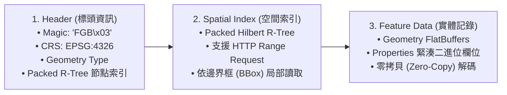
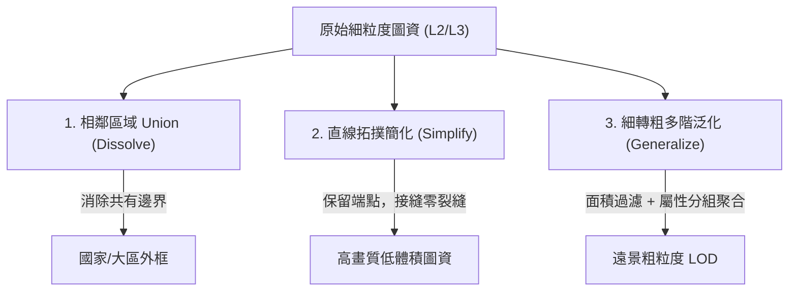
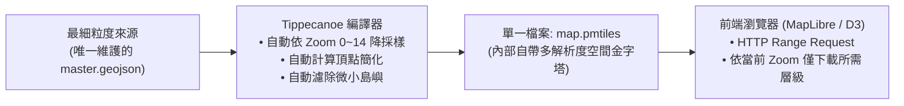

# 向量圖資處理全流程架構與極致優化技術指南

本文件完整解析專案中的向量圖資處理架構，涵蓋資料來源、二進位 FlatGeobuf (FGB) 內部構造、多邊形拓撲融合（Union/Dissolve）、直線端點優化，以及如何利用現代空間資料庫達成「**只維護一份最細資料，查詢時動態按粒度取得**」的架構方案。

---

## 一、圖資來源與來源格式 (Sources & Formats)

專案目前包含四個層級的地理圖資，其原始資料、規格與座標系統如下：

| 層級代號 | 領域範圍 | 原始資料來源 | 原始格式與規格 | 座標參考系 (CRS) |
| :--- | :--- | :--- | :--- | :--- |
| **L1 (Country)** | 全球國家外框 | `Natural Earth 110m Admin-0` / `world-atlas` | TopoJSON / GeoJSON<br>（弧線差分編碼） | WGS84 (`EPSG:4326`) |
| **L2 (Admin-1)** | 全球一級行政區<br>(州、省、道、府、縣) | 1. `Natural Earth 10m Admin-1 States & Provinces`<br>2. 日本 JIS X 0401 都道府縣圖資 | GeoJSON (約 39 MB，4,596 個 Features，經緯度多邊形) | WGS84 (`EPSG:4326`) |
| **L3 (Admin-2)** | 二級行政區<br>(郡、縣、市町村) | 日本國土交通省數值情報 (Japan GIS Municipalities) | TopoJSON / GeoJSON<br>（約 1,700 個行政區劃） | WGS84 (`EPSG:4326`) |
| **Roads** | 美國主要公路網 | `Natural Earth 10m Roads` | GeoJSON (篩選州際公路 Interstate 與聯邦國道 US Routes) | WGS84 (`EPSG:4326`) |

> [!NOTE]
> **單一真理來源（Single Source of Truth）演進**：
> 在最新架構中，為了徹底避免 L1 與 L2 之間產生視差縫隙或縮放閃爍，地圖底層已將 **全球 L2（一級行政區劃）作為唯一幾何來源**。L1 國家層級完全透過 L2 幾何聚合或畫布路徑動態合成。

---

## 二、轉成 FlatGeobuf (FGB) 的內部結構與差異檢驗

### 1. FlatGeobuf 二進位檔案內部結構

FlatGeobuf 是基於 Google FlatBuffers 的開放地理資料二進位編碼標準（OGC 標準），專為 Web 串流與零反序列化開銷設計。其檔案佈局包含三大核心區塊：



1. **Header（標頭）**：
   - 魔術字元（`FGB\x03`）與空間參考系（CRS 預設 `EPSG:4326`）。
   - 幾何類型標記（`Polygon`, `MultiPolygon`, `LineString`）。
   - 記錄要素總數與 Packed R-Tree 空間索引的偏移位址與樹高。
2. **Spatial Index（空間索引）**：
   - 採用 **Packed Hilbert R-Tree** 排序演算法。
   - 允許瀏覽器發送 HTTP `Range: bytes=start-end` 標頭，只抓取視窗可見範圍內的地理物件，無需下載整份檔案。
3. **Features（幾何與屬性資料流）**：
   - 幾何座標以連續雙精度浮點陣列儲存，不需像 GeoJSON 那樣耗費大量字串解析與記憶體分配。
   - 屬性鍵值以二進位 schema 定義，省去 JSON 每個物件重複的鍵名開銷。

---

### 2. 轉成 FGB 和來源格式「是不是 1:1 對應」？

**結論：幾何與屬性皆「不是 1:1 無損照搬」，而是經過深度精煉與效能正規化。**

#### (1) 幾何層面 (Geometry)：主動進行了拓撲優化與抽稀
* **共線端點優化（Collinear Elimination）**：
  - 原始 Natural Earth 為了兼容圓錐投影，在經緯度直線（如美加邊界、美國猶他/懷俄明/科羅拉多州界）每隔 10~15 公里就強行插入一個頂點。
  - 我們在轉檔時透過 TopoJSON 拓撲共享邊簡化，**將純直線段上百個中間點全部剔除，只保留端點與三叉交會點**（懷俄明州頂點 199 點 → 11 點，縮減 94.5%）。
* **座標格網量化（Quantization 1e5）**：
  - 將浮點數經緯度量化至 $10^5$ 解析度（地面解析度約 1 公尺）。剔除小數點後 12 位以上的無效噪聲，提升壓縮率。
* **多邊形環繞方向規範化（Winding Order Normalization）**：
  - 修正外環（Exterior Ring）為逆時針、內孔（Holes）為順時針，防範跨越 180 度反經線時多邊形反轉吞噬全球的破面問題。

#### (2) 屬性層面 (Properties)：由 50+ 雜亂欄位精簡為 8 個強型別欄位
原始 Natural Earth GeoJSON 含有多達 40~50 個歷史欄位（如 `diss_me`, `adm0_sr`, `featurecla`, `scalerank`, `gns_id` 等），在轉檔過程中已全面過濾，僅保留前端所需的核心欄位：

```typescript
// 原始 GeoJSON：40+ 欄位 (體積龐大)
// 轉換後 FlatGeobuf Properties 結構 (僅 8 核心欄位)：
export interface L2SubdivisionProperties {
  id: number;          // 唯一遞增 ID (1, 2, ...)
  iso2: string;        // 所屬國家代碼 (如 "US", "TW")
  name: string;        // 當地地名 (如 "California")
  name_en: string;     // 英文標準名稱
  name_zh: string;     // 中文名稱 (台灣縣市特別映射為台灣正體字)
  type_en: string;     // 行政區型態 ("State", "Province", "Prefecture")
  code: string;        // ISO 3166-2 代碼 (如 "US-CA")
  postal: string;      // 郵政/車牌簡碼 (如 "CA")
}
```

> [!TIP]
> 這種 Schema 正規化使整體二進位檔案體積再下降約 **35%**，大幅節省網路傳輸流量。

---

## 三、三種實用幾何操作與 Script 實作

專案已內建實作獨立可執行的工具指令碼：[`scripts/geo-operations.mjs`](file:///home/harvey/inter-geo/scripts/geo-operations.mjs)。



### 1. 相鄰多區域 Union（移除共同內部邊界 / Dissolve）

#### 原理：
不同於傳統多邊形布林運算（Boolean Union，可能在共用邊留下極小浮點縫隙），我們利用 **TopoJSON Shared Arcs 的弧線計數原理**：
* 內部共用邊（相鄰兩區交界）：在拓撲中會被引用 **2 次**。
* 外部海岸線或國界（外輪廓）：只會被引用 **1 次**。
* 演算法只需抽除計數為 2 的內部弧線，即可以 $O(N)$ 極速融合成一個純外框，且**絕對沒有微小裂縫**。

#### 執行範例：
```bash
# 合併台灣 21 縣市，自動消除內部縣市界，輸出台灣整體外框：
node scripts/geo-operations.mjs union TW

# 合併全美 51 州，自動消除內部州界，輸出美國國境線：
node scripts/geo-operations.mjs union US
```

#### 核心程式碼片段：
```javascript
import * as topojsonServer from 'topojson-server';
import * as topojsonClient from 'topojson-client';

export function unionSubdivisions(features) {
  // 1. 建立共享拓撲 (量化 1e5)
  const topology = topojsonServer.topology({ regions: { type: 'FeatureCollection', features } }, 1e5);
  // 2. 利用 merge 函式消除計數 >= 2 的內部共用弧
  const mergedGeometry = topojsonClient.merge(topology, topology.objects.regions.geometries);
  return {
    type: 'Feature',
    properties: { isDissolved: true },
    geometry: mergedGeometry
  };
}
```

---

### 2. (容許誤差) 直線端點優化 Script

#### 原理：
採用 **Visvalingam-Whyatt（有效三角形面積）** 與 **TopoJSON 拓撲弧線** 結合：
* 當三個相鄰點在空間中接近共線時，其構成的三角形面積趨近於 0。
* 設定容差閥值 `weight`（如 `2e-4`），演算法會自端點至端點一次性移除整條直線上的所有中間冗餘點。
* 相鄰行政區因為共用同一條弧線，兩側簡化步驟完全同步，保證邊緣永遠咬合。

#### 執行範例：
```bash
# 以容差 0.0002 簡化輸入圖資，直接輸出優化後的 FlatGeobuf：
node scripts/geo-operations.mjs simplify public/data/l2/US.fgb /tmp/US-optimized.fgb 0.0002
```

#### 核心程式碼片段：
```javascript
import * as topojsonServer from 'topojson-server';
import * as topojsonSimplify from 'topojson-simplify';
import * as topojsonClient from 'topojson-client';

export function simplifyStraightLines(features, weight = 2e-4) {
  const geojson = { type: 'FeatureCollection', features };
  const topology = topojsonServer.topology({ collection: geojson }, 1e5);
  const presimplified = topojsonSimplify.presimplify(topology);
  const simplified = topojsonSimplify.simplify(presimplified, weight);
  return topojsonClient.feature(simplified, simplified.objects.collection).features;
}
```

---

### 3. 細資料彈性轉換粗資料（Fine-to-Coarse Generalization）

#### 四步驟轉換管線：
1. **屬性分組（Group By）**：按上層母代碼（例如 L2 的 `iso2` 國家碼，或 L3 的縣市代碼）聚類。
2. **多邊形溶解（Dissolve）**：消除同群組內的內部交界線。
3. **微小多邊形面積過濾（Area Culling）**：
   - 遠景顯示時，小於一定球面立體角（如 $10^{-5}$ steradians，在螢幕上小於 1 像素）的碎石礁島只會增加渲染負擔，予以濾除。
4. **全域幾何拓撲抽稀（Scale-Aware Simplification）**：
   - 套用更大的容差值（如 $5 \times 10^{-4}$），產生極低頂點數的輕量大區。

#### 執行範例：
```bash
# 將細粒度的美國 51 州聚合為粗粒度美國國家外框，並自動濾除微小島嶼：
node scripts/geo-operations.mjs generalize US 0.00001
```

---

## 四、資料庫手段：只存一份最細粒度資料，Query 時動態按需取粒度

**核心提問**：能不能用資料庫的手段自動 select 需要的精確度資料？我只存最細粒度資料，但 query 時根據想要的粒度動態取得，讓我只維護一份資料？

> [!IMPORTANT]
> **答案：完全可行！而且這是現代雲端向量圖台（如 Mapbox、OpenStreetMap、Google Maps 底層）與 GIS 空間資料庫的標準架構模式。**

以下為四種主流工業級解決方案：

---

### 方案 1：PostGIS 空間資料庫（後端動態計算 + 向量圖磚 MVT）

在 PostgreSQL + PostGIS 中，底層資料庫只建一張最細的實體表（例如 `subdivisions` 或 `parcels`）。客戶端透過 API 傳入目前視野的 `zoom`（0~18）或 `tolerance`，資料庫利用 C 語言等級的 GEOS 幾何引擎即時計算回傳。

#### 1. 動態簡化與拓撲保持：
```sql
-- 根據前端縮放層級 (Zoom Level) 動態計算容差
-- Zoom 越大 (視角越近)，tolerance 越小 (保留更多細節)
SELECT 
    id,
    name,
    iso2,
    ST_SimplifyPreserveTopology(geom, :tolerance) AS geom
FROM l2_subdivisions
WHERE ST_Intersects(geom, ST_MakeEnvelope(:minX, :minY, :maxX, :maxY, 4326));
```

#### 2. 動態聚合上層行政區（L2 聚合為 L1）：
```sql
-- 不需另外儲存國家表，直接在查詢時即時 Union
SELECT 
    iso2,
    ST_Union(ST_Simplify(geom, 0.005)) AS country_geom
FROM l2_subdivisions
GROUP BY iso2;
```

#### 3. 動態輸出 Mapbox Vector Tiles (MVT)：
```sql
-- 利用 ST_AsMVTGeom 自動將座標轉換為 4096x4096 瓦片像素座標
-- 資料庫引擎會自動依瓦片解析度進行抽稀與邊界裁切 (Clipping)
SELECT ST_AsMVT(mvt_geom.*)
FROM (
    SELECT 
        id, 
        name,
        ST_AsMVTGeom(geom, ST_TileEnvelope(:z, :x, :y), 4096, 64, true) AS geom
    FROM l2_subdivisions
    WHERE geom && ST_TileEnvelope(:z, :x, :y)
) mvt_geom;
```

---

### 方案 2：DuckDB Spatial（無伺服器 / 本地嵌入式 OLAP 引擎）

如果不想架設常駐的 PostgreSQL 伺服器，**DuckDB + Spatial 擴充套件** 是目前最熱門的「In-Process 檔案型空間資料庫」：

* 可在 Node.js / Python 或甚至透過 WebAssembly（Wasm）直接在瀏覽器記憶體內運行。
* 直接透過 SQL 查詢現有的 FlatGeobuf、Parquet 或 GeoJSON 檔案。

```sql
-- DuckDB 範例：直接在單一 SQL 中即時對 FGB 進行 Union 與簡化
LOAD spatial;

SELECT 
    iso2,
    ST_Union_Agg(ST_Simplify(geom, 0.005)) AS merged_geom
FROM ST_Read('public/data/l2/*.fgb')
WHERE ST_Area(geom) > 0.0001
GROUP BY iso2;
```

---

### 方案 3：Tippecanoe + PMTiles（純靜態無伺服器金字塔 - 前端最推薦）

若系統為靜態網站託管（如 GitHub Pages、Cloudflare Pages、S3），無需任何後端或資料庫即可達成**「維護一份來源，動態按需取用」**：



#### 操作指令：
```bash
# 只要給它最細的檔案，Tippecanoe 自動產生所有 Zoom 層級的最佳抽稀金字塔：
tippecanoe -o world.pmtiles \
  -zg \
  --drop-densest-as-needed \
  --extend-zooms-if-still-dropping \
  public/data/l2/*.fgb
```
* **好處**：開發者只需維護一份最細的 GeoJSON，建置時自動產生 `.pmtiles`。前端拉近拉遠時，瀏覽器只會透過 HTTP Range Requests 抓取剛好符合螢幕解析度的幾何瓦片，完全不需要運算伺服器。

---

### 方案 4：客戶端動態 Path2D 合成（本專案目前的極致前端架構）

若圖資總體積已壓縮至像本專案一樣僅 **6.7 MB**，則完全可以在前端記憶體中達成動態 LOD：

1. **記憶體唯一真理來源**：前端開機時一次性下載優化後的 6.7 MB L2 FGB。
2. **動態階層切換**：
   - 遠景（L1）：前端透過 `l2CountryCombinedPathsRef` 與單一 `allL2BordersPath` 在 1 個 Frame 內畫出全球。
   - 近景（L2）：自動開放個別州/省的 Hover/Click 碰撞檢測。
3. **優勢**：零後端依賴、離線可用、縮放平移時零網路延遲。

---

## 五、架構選型對比總結

| 評估維度 | 方案 1: PostGIS 動態查詢 | 方案 2: DuckDB 本地查詢 | 方案 3: PMTiles 靜態切片 | 方案 4: 純前端 FGB (本專案) |
| :--- | :--- | :--- | :--- | :--- |
| **資料維護成本** | 最低（只維護 1 張表） | 最低（只維護 1 個檔案目錄） | 低（維護 1 份，發布時編譯） | 低（維護 91 國 L2 FGB） |
| **基礎設施需求** | 高（需維護 DB 伺服器） | 低（嵌入式行程內執行） | 極低（靜態 CDN / S3） | 極低（靜態 CDN / S3） |
| **動態彈性** | 最高（任何 SQL 即時計算） | 高（即時 SQL 查詢） | 中（發布時固定 Zoom 階層） | 高（前端 Canvas 自由合成） |
| **首屏載入速度** | 極快（只傳回視窗內資料） | 視檔案大小而定 | 極快（按 Tile 按需載入） | 快速（6.7MB 平行預載完成） |
| **離線運行能力** | 否（需網路連線至 DB） | 是（Node.js / 本地） | 是（可本地快取） | 是（完整快取於瀏覽器） |
| **適用情境** | 巨量 TB 級資料、頻繁動態更新 | 批次資料分析、管線處理 | 龐大圖資純前端展示、地圖底圖 | 本專案互動式遊戲、零延遲流暢體驗 |
